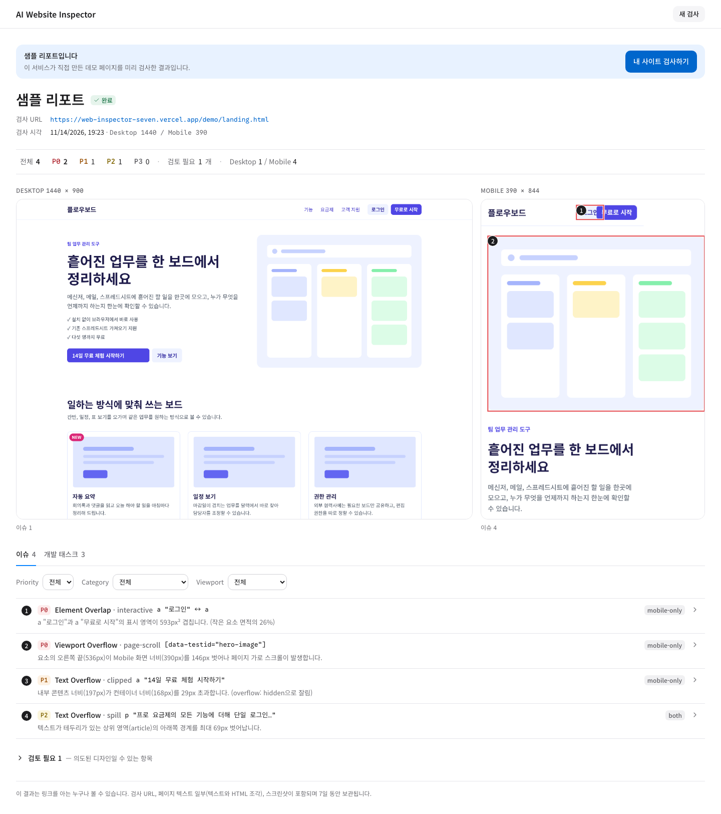
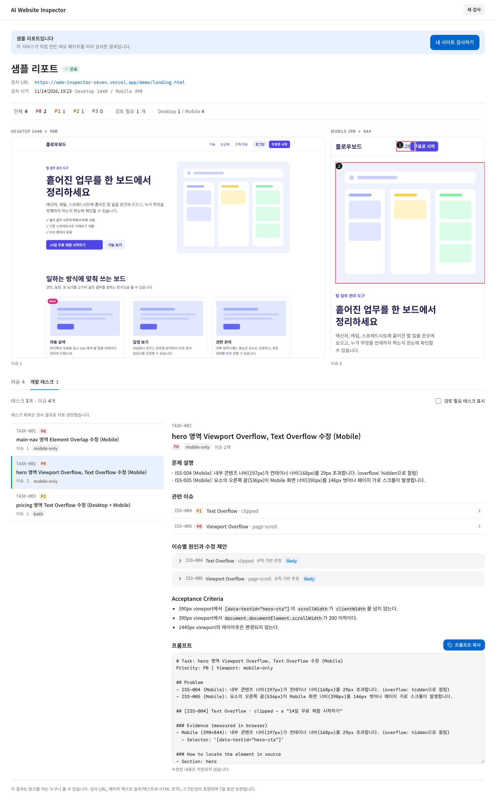
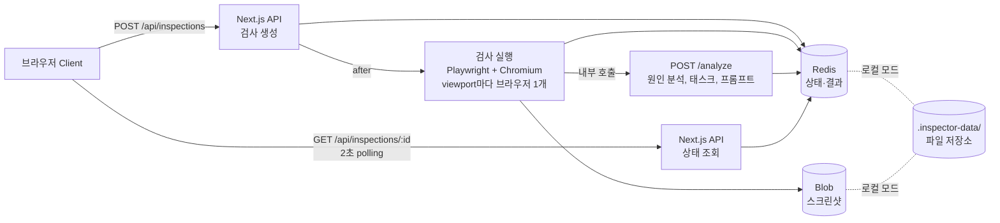

# AI Website Inspector

웹 페이지 URL을 검사해 UI 문제(텍스트 넘침, 요소 겹침, 화면 넘침)를 측정 증거와 함께 찾고, 코딩 에이전트에게 넘길 수정 프롬프트를 만드는 도구입니다.

## 2. 바로 보기

- [체험 데모](https://web-inspector-seven.vercel.app): 공개 URL을 입력해 검사합니다.
- [샘플 리포트](https://web-inspector-seven.vercel.app/report/sample): 이 저장소의 데모 페이지(`public/demo/landing.html`)를 production에서 검사한 결과입니다. 이슈 5개(P0 2, P1 1, P2 2), 개발 태스크 4개입니다.
- [Before/After 비교](https://web-inspector-seven.vercel.app/showcase): 데모 페이지에 심은 문제 5개를 태스크 프롬프트대로 고친 사례입니다. 데이터를 넣은 뒤 배포하면 열립니다([8장](#8-before--after-사례)).

배포본은 무료 서버리스 환경이라 동시 검사가 1건이고 촬영이 느립니다. 개발 중인 화면(`localhost`)을 검사하려면 [로컬 모드](#4-로컬에서-쓰기)를 권장합니다.

---

## 3. 동작 흐름

URL 입력 → Desktop(1440×900)·Mobile(390×844, iPhone 14 에뮬레이션) 렌더링 → 요소 측정 → 탐지 → 묶기·우선순위 → 리포트 → 수정 태스크와 프롬프트 복사

| 결과 화면 | 개발 태스크와 프롬프트 |
|---|---|
|  |  |

두 화면 모두 [샘플 리포트](https://web-inspector-seven.vercel.app/report/sample)입니다. 이슈마다 측정값(px), 소스에서 위치를 찾는 단서(Source Hints), 원인 후보, 우선순위(P0~P3)가 붙고, 같은 영역·같은 viewport의 이슈는 개발 태스크 하나로 묶입니다. 프롬프트는 이런 모양입니다(샘플 리포트 `TASK-002`의 일부).

````markdown
## Problem
- ISS-005 (Mobile): 요소의 오른쪽 끝(536px)이 Mobile 화면 너비(390px)를 146px 벗어나 페이지 가로 스크롤이 발생합니다.

### Likely Root Cause (likely, rule-based)
요소 너비가 화면 너비보다 커서 고정 너비로 추정됨. 근거(Mobile): `width: 520px`, `max-width: none`, 요소 너비 520px, 화면 너비 390px

## Acceptance Criteria
- 390px viewport에서 `document.documentElement.scrollWidth`가 390 이하이다.
- 1440px viewport의 레이아웃은 변경되지 않는다.
````

---

## 4. 로컬에서 쓰기

요구 사항: Node.js 24.x(`package.json`의 `engines`), pnpm 10, 그리고 로컬 Chromium.

```bash
pnpm install
pnpm exec playwright install chromium
pnpm dev:local
```

http://127.0.0.1:3000 을 엽니다.

- Upstash Redis와 Vercel Blob 값이 없으면 검사 결과를 `.inspector-data/`의 파일에 저장합니다. 외부 계정 없이 동작합니다.
- 로컬 모드(`INSPECTOR_MODE=local`)에서만 `localhost`, `*.localhost`, `127.0.0.0/8`, `::1` 검사를 허용합니다. 서버는 `127.0.0.1`에만 바인딩합니다.
- 사설망 주소(예: 같은 네트워크의 개발 서버)는 `LOCAL_ALLOW_HOSTS`에 호스트 이름이나 IP를 쉼표로 정확히 적어야 허용됩니다. 와일드카드와 대역 표기는 받지 않습니다.
- 모드와 관계없이 `169.254.0.0/16`(클라우드 메타데이터), `fe80::/10`, `0.0.0.0`, `::`은 항상 차단합니다.
- `INSPECTOR_MODE=local`인데 `VERCEL` 환경변수가 있으면 서버 시작 단계에서 실패하므로 배포본에서는 켜지지 않습니다.
- 한계: 로컬 모드는 loopback을 허용하므로, 검사한 외부 페이지가 이 PC의 다른 로컬 서비스에 요청을 보낼 수 있습니다. 신뢰하는 페이지만 검사하세요.

테스트:

```bash
pnpm test
pnpm test:fixtures
pnpm test:security
```

---

## 5. 설계 원칙

- **Evidence First.** 모든 이슈는 브라우저에서 측정한 값과, 템플릿으로 만든 근거 문장을 가집니다. "느낌상 깨져 보인다"가 아니라 "요소가 화면을 146px 벗어난다"를 보여줘야 개발자가 믿고 고칠 수 있기 때문입니다.
- **Deterministic Core.** 측정값, 이슈 ID, selector, 우선순위, 태스크 묶기, 프롬프트 조립은 코드만 정하고, 같은 측정 데이터면 같은 결과가 나옵니다. 해당 코드에서는 난수, 현재 시각, AI 호출을 쓰지 않고 우선순위는 정수 연산으로 비교합니다. 결과가 재현되어야 테스트할 수 있고, 모델 출력이 이슈의 존재 여부를 바꾸지 못해야 오탐을 통제할 수 있습니다.
- **스크린샷은 표시용입니다.** 탐지는 스크린샷이 아니라 DOM 측정값으로만 합니다. 서버리스에서는 촬영이 느리고 실패할 수 있어서, 촬영에 실패해도(`SCREENSHOT_FAILED`) 측정 결과와 이슈는 남기고 화면에는 페이지 구성 배치도로 대신 보여줍니다.

---

## 6. 아키텍처



- 함수 사이에 메모리를 공유하지 않으므로 상태와 결과는 Redis, 스크린샷은 Blob에 둡니다. API 응답에는 Blob URL만 넣습니다.
- 브라우저 검사와 분석을 다른 함수로 나눠, 분석이 실패해도 검사 결과는 남습니다.
- 외부 URL을 서버의 브라우저로 여는 서비스라 SSRF를 먼저 막았습니다. 처음 URL, 리다이렉트의 모든 hop(브라우저에 맡기지 않고 서버가 hop마다 검사), 하위 요청(이미지·스크립트·iframe·팝업)을 같은 규칙으로 검사하고, WebSocket은 모두 차단합니다. 차단 범주는 loopback, 사설 IP, link-local, 클라우드 메타데이터 주소, 내부 호스트 이름이며 10진수·16진수 표기와 IPv4-mapped IPv6도 안에 든 IPv4로 판정합니다. 남는 위험으로 DNS rebinding은 완전히 막지 못합니다.

---

## 7. 탐지 규칙과 정확도

| 규칙 | 내용 |
|---|---|
| Text Overflow | 텍스트가 요소 안에서 잘리거나(`clipped`) 테두리 밖으로 넘치는(`spill`) 경우. 텍스트 영역은 `Range.getClientRects()`로 측정합니다 |
| Element Overlap | 인터랙티브 요소끼리, 텍스트끼리 등 겹치면 안 되는 요소의 겹침. 이슈는 대상 요소 + 종류마다 하나로 묶습니다 |
| Viewport Overflow | 요소가 화면을 벗어나 페이지 가로 스크롤이 생기거나(`page-scroll`) 화면 밖에서 잘리는(`hidden-clip`) 경우 |

`ellipsis`, 가로 스크롤 캐러셀, sticky 헤더, 오프캔버스 메뉴, 쿠키 배너, 스크린리더 전용 텍스트처럼 의도된 디자인은 제외 규칙으로 거르고, 애매한 것은 `Needs Review`로 따로 둡니다.

`pnpm test:fixtures`는 로컬 브라우저로 Fixture 15종(Positive 6, Negative 9)을 검사해 기대 결과와 비교합니다. 아래는 `--repeat 2`로 실행한 결과입니다(macOS 로컬). Fixture는 모두 같은 폰트(Noto Sans KR)를 `@font-face`로 불러옵니다.

| 규칙 | Fixture 수 | 기대 이슈 탐지 | 오탐 |
|---|---:|---|---|
| Text Overflow | Positive 2 (P-02, P-05) | 2/2 | - |
| Element Overlap | Positive 1 (P-03) | 1/1 | - |
| Viewport Overflow | Positive 3 (P-01, P-04, P-06) | 3/3 | - |
| 의도된 디자인 (제외 규칙) | Negative 9 (N-01~N-09) | - | 0/9 |

- Positive는 유형·우선순위·viewport까지 기대와 일치해야 통과이고, 6/6입니다.
- Negative는 확정 이슈가 0개여야 통과이고 0/9입니다. N-07(이미지 위 배지)에서 `Needs Review` 1건이 나왔는데, 확정 이슈가 아니라서 기준에서 허용합니다.
- 두 번 실행한 결과가 같았습니다(결정성). Fixture 1개당 평균 검사 시간(Desktop + Mobile)은 2,618ms였습니다.
- `pnpm test` 777개(50개 파일), `pnpm test:security` 19개가 통과했습니다.

한계: Fixture 15종은 직접 만든 페이지라 실제 사이트에서의 정확도를 보장하지 않습니다. 실제 사이트에 대한 정밀도·재현율은 측정하지 않았습니다.

---

## 8. Before / After 사례

대상은 이 저장소의 데모 페이지입니다. Before는 [`public/demo/landing.html`](public/demo/landing.html)(일부러 문제 5개를 넣은 랜딩 페이지), After는 같은 페이지를 고친 [`public/demo/landing-fixed.html`](public/demo/landing-fixed.html)입니다. 흐름은 "검사 → 생성된 태스크 프롬프트의 Required Changes를 코딩 에이전트(Claude Code)가 적용 → 다시 검사"입니다.

- 화면: [/report/before](https://web-inspector-seven.vercel.app/report/before) · [/report/after](https://web-inspector-seven.vercel.app/report/after) · [/showcase](https://web-inspector-seven.vercel.app/showcase) (배포본에는 이 데이터를 넣은 뒤 배포해야 열립니다)
- 데이터: `public/showcase/before`, `public/showcase/after` (`pnpm import-sample`로 가져온 검사 결과와 스크린샷)
- 비교 결과 전문: [docs/assets/showcase-compare.md](docs/assets/showcase-compare.md) (`pnpm compare-inspections`)

| Priority | Before | After |
|---|---:|---:|
| P0 | 2 | 0 |
| P1 | 1 | 0 |
| P2 | 1 | 0 |
| Needs Review | 1 | 0 |
| 합계 (개발 태스크) | 5 (4) | 0 (0) |

해결된 이슈와 적용한 수정(태스크 프롬프트의 Required Changes를 그대로 따랐습니다):

| 이슈 | 문제 | 수정 |
|---|---|---|
| ISS-005 P0, Mobile | Hero 이미지가 `width: 520px` 고정이라 오른쪽 끝(536px)이 화면 너비(390px)를 146px 벗어나 가로 스크롤 발생 | `width: 100%; max-width: 520px; height: auto` |
| ISS-003 P0, Mobile | `position: absolute`로 붙인 "로그인"과 "무료로 시작" 버튼이 593px²(작은 요소 면적의 26%) 겹침 | absolute 제거, 부모의 `flex` + `gap`으로 배치 |
| ISS-004 P1, Mobile | CTA가 `white-space: nowrap` + `overflow: hidden`이라 내용 너비 197px가 컨테이너 168px를 넘어 문구가 잘림 | `white-space: normal` |
| ISS-002 P2, both | 요금제 카드 높이가 260px 고정이라 안내 문구가 69px 넘침 | `height` → `min-height` |
| ISS-001 Needs Review | 배지가 absolute라 이미지와 304px²(54%) 겹침. 프롬프트에 원인 분석이 없어(Needs Review) 직접 판단해 수정 | 배지를 이미지 아래 흐름 안에 배치 |

남은 이슈와 새로 생긴 이슈는 없습니다. 다만 이 결과가 말하는 범위는 한정적입니다.

- 이 사례는 **내가 만든 데모 페이지에 문제를 심은 것**이라, 실제 사이트에서 이슈를 해결한 사례가 아닙니다. 수정 전 상태가 5개로 나오는 것도 처음부터 의도한 값입니다(production 샘플 리포트와 같은 5개).
- After의 0개는 "탐지 규칙 3종에 걸리는 문제가 없다"는 뜻이지, 페이지에 문제가 없다는 보장이 아닙니다.
- 수정은 이 저장소 작업 중 코딩 에이전트가 프롬프트를 보고 적용했고, 별도로 독립된 에이전트 실행을 만들지는 않았습니다.
- 두 번의 검사는 모두 **로컬 모드(macOS)** 에서 했습니다. 검사 기준 환경은 Vercel이지만, 페이지가 Fixture처럼 같은 웹 폰트를 쓰므로 Before 결과가 production 샘플과 같은 이슈 5개로 나왔습니다.

운영 중 겪은 문제와 대응은 아래 9장에 있습니다.

---

## 9. 운영 환경에서 찾은 문제와 진단

Vercel(Hobby, 1 vCPU / 2GB, Fluid compute, `playwright-core` + `@sparticuz/chromium`)에서 검사를 돌리며 발견한 문제입니다. 전체 기록은 [docs/DIAGNOSTICS.md](docs/DIAGNOSTICS.md)에 있습니다.

**D-01. Mobile 검사가 멈춤**
- 증상: Mobile 검사가 약 179초 동안 끝나지 않았습니다.
- 원인: `@sparticuz/chromium`은 `--single-process`로 실행되어 브라우저 하나에 컨텍스트를 하나만 열 수 있습니다. 한 브라우저에서 Desktop 다음 Mobile 컨텍스트를 열면 멈췄고, 타임아웃도 실제 실행을 끊지 못했습니다.
- 대응: 뷰포트마다 새 브라우저를 띄워 순차 실행합니다. 모든 단계를 `Promise.race` 타임아웃으로 감싸고, 시간 초과 시 프로세스를 강제 종료합니다.
- 기록: [D-01](docs/DIAGNOSTICS.md)

**D-02. 실행을 반복하면 인스턴스가 느려짐**
- 증상: 같은 인스턴스에서 8~9번 실행한 뒤부터 느려지거나 실패했습니다.
- 원인: 종료된 Chromium의 크래시 덤프가 `/tmp`에 쌓여 용량을 채웠습니다.
- 대응: 검사 시작 전과 종료 후 `/tmp`의 Chromium 임시 파일을 정리합니다.
- 결과: 정리 후 연속 26회 실행이 모두 성공했습니다.
- 기록: [D-02](docs/DIAGNOSTICS.md)

**D-03. Desktop 스크린샷이 느리고 자주 실패**
- 측정: Desktop 스크린샷은 로컬에서 0.1~0.3초, production에서 12~60초가 걸렸습니다.
- 원인: 서버리스 환경에는 GPU가 없어 렌더링이 CPU(SwiftShader)로 처리됩니다. 특히 WebGL·애니메이션이 있는 페이지에서 크게 느려집니다.
- 효과가 없던 시도: CDP 설정, `requestAnimationFrame` 일시 정지, JS 실행 정지. 같은 페이지에서 재시도하면 같은 이유로 다시 실패했습니다.
- 대응: 스크린샷은 표시용이므로 실패해도 측정 결과는 남깁니다(상태는 `completed` 유지, `SCREENSHOT_FAILED`는 스크린샷 실패만 뜻합니다). 실패한 영역은 측정한 레이아웃 정보로 그린 배치도로 대체합니다.
- 기록: [D-03](docs/DIAGNOSTICS.md)

**D-04. 검사 브라우저의 WebGL을 끄지 않기로 결정**
- 제안: GPU가 없어 느리니 검사용 브라우저에서 WebGL을 비활성화하자는 의견이 있었습니다.
- 결정: 채택하지 않았습니다.
- 이유: WebGL을 쓰는 사이트는 WebGL이 없으면 오류 화면이나 빈 화면을 띄웁니다. 그 화면을 검사하면 실제 사이트에 문제가 있어도 "이슈 0건"이라는 잘못된 결과가 나옵니다. 느린 것보다 틀린 결과를 내는 것이 더 나쁘다고 판단했습니다.
- 기록: [D-04](docs/DIAGNOSTICS.md)

---

## 10. 한계와 확장 계획

지금의 한계:

- **원인 분석은 규칙 기반 추정입니다. AI를 쓰지 않습니다.** 측정값과 계산된 CSS 값으로 원인 후보를 고르고 `likely`/`uncertain`으로 표시합니다. 맞는 규칙이 없으면 `uncertain`입니다.
- 배포본은 동시 검사 1건이고 초과 요청은 429로 안내합니다. 1 vCPU에서 Chromium 두 개가 겹치면 둘 다 시간 초과될 가능성이 높아서, 둘 다 실패하는 것보다 하나를 확실히 성공시키는 쪽을 택했습니다([D-05](docs/DIAGNOSTICS.md)).
- 서버리스에서는 촬영이 느리고, WebGL 페이지는 스크린샷 없이 끝날 수 있습니다. canvas 안의 그래픽은 DOM으로 검사할 수 없어 canvas의 위치와 그 위의 DOM만 검사합니다.
- 탐지 규칙은 정적 3종이고 초기 로드 상태만 봅니다(hover, 메뉴 열기, 스크롤 뒤 요소 제외). 로그인이 필요한 페이지, 크롤링도 범위 밖입니다.
- 봇 차단 사이트는 검사에 실패할 수 있고, Chromium 기준이라 Safari 등과 렌더링이 다를 수 있습니다.

확장 계획(구현하지 않았고, 아래는 설계 방향입니다):

- **검사 워커 분리:** 검사를 실행하는 워커를 Docker로 분리하고 대기열에서 하나씩 꺼내 처리합니다. 동시 처리 수는 서버 vCPU·메모리에 비례해 늘어나는 구조입니다(수치는 **추정**이며 측정 예정, [D-05](docs/DIAGNOSTICS.md)). 워커가 GPU 있는 환경이면 촬영 문제가 줄 것으로도 **추정**합니다.
- **AI 원인 분석(T15):** 규칙 분석 자리(`analyzeIssues`)를 AI 호출로 바꿉니다. 출력은 zod 스키마로 검증하고, 실패하면 규칙 분석 결과를 그대로 씁니다. 측정값·ID·우선순위는 계속 코드만 정합니다.
- 이전 검사와의 비교를 서비스 기능으로 옮기고, 인터랙션 상태 검사와 추가 viewport를 검토합니다.

---

## 11. 에이전트로 만든 방법

사람이 문서를 쓰고 판단하며, AI 코딩 에이전트(Claude Code, Codex)가 구현과 테스트를 맡았습니다. 자세한 내용은 [docs/AGENT_WORKFLOW.md](docs/AGENT_WORKFLOW.md)에 있습니다.

**문서 체계**

| 문서 | 역할 |
|---|---|
| [PRD](docs/PRD.md) | 기능, 임계값, 데이터 모델의 단일 기준. 다른 문서와 다르면 PRD를 따릅니다 |
| [USER_FLOW](docs/USER_FLOW.md) → [WIREFRAME](docs/WIREFRAME.md) → [DESIGN_GUIDE](docs/DESIGN_GUIDE.md) | 화면 흐름 → 화면 구조 → 색·타이포·간격 |
| [DETECTION_RULES](docs/DETECTION_RULES.md) | 탐지, Dedup, Priority 구현 명세와 Fixture 기대 결과 |
| [DOMAIN_MODEL](docs/DOMAIN_MODEL.md) | 불변 조건, 상태 전이, 저장 방식 |
| [AGENTS.md](AGENTS.md) | 폴더 책임, import 방향, 절대 깨면 안 되는 불변 조건, 금지 사항, 보고 형식 |

**작업 단위와 규칙**

- 작업을 T01~T14로 나눠, 작업 하나를 새 에이전트 세션 하나에서 진행하고 작업 사이에 커밋했습니다. 통과해야 다음으로 넘어가는 게이트를 세 곳에 두었습니다: Vercel에서 서버리스 Chromium 실행(T02), Fixture 테스트와 기대값 무변경(T06), preview 배포의 파이프라인(T09).
- 에이전트가 문서와 다른 결정이 필요하면 멈추고 보고합니다. 사람이 판단하고, 받아들이면 다음 작업 전에 문서에 먼저 반영합니다.
- 초기 세팅, 외부 서비스 설정, 배포, 배포 환경 검증은 사람이, 구현과 테스트는 에이전트가 했습니다. 에이전트는 배포 명령을 실행하지 않고, 테스트를 통과시키려고 Fixture 기대값을 바꾸지 않습니다.

**에이전트가 제안을 반박한 사례** (근거: [docs/DIAGNOSTICS.md](docs/DIAGNOSTICS.md) D-04)

- GPU가 없어 느리니 검사용 브라우저에서 WebGL을 끄자는 제안이 있었습니다. 코딩 에이전트가 근거와 함께 반박했고 채택하지 않았습니다. WebGL을 쓰는 사이트는 WebGL이 없으면 오류 화면이나 빈 화면을 띄우는데, 그 화면을 검사하면 실제로는 문제가 있어도 "이슈 0건"이라는 잘못된 결과가 나옵니다. 느린 것보다 틀린 결과를 내는 것이 더 나쁘다고 판단했습니다.

**에이전트가 문서를 고치게 한 사례** (근거: [docs/AGENT_WORKFLOW.md](docs/AGENT_WORKFLOW.md), 커밋)

- 문서가 화면 이탈 판정에 `innerWidth`를 쓰도록 했는데, 수집을 구현하던 에이전트가 Mobile에서 콘텐츠가 넘치면 Chromium이 페이지를 축소해 `innerWidth`가 바뀐다는 것을 측정했습니다(P-01 616×1334). 판정 기준을 바꾸도록 문서를 함께 고쳤습니다(`aa21caf`).
- SSRF 차단을 구현하던 에이전트가 Playwright route가 리다이렉트의 다음 URL을 다시 가로채지 않는다는 것을 통합 테스트로 확인했습니다. 리다이렉트를 서버가 hop마다 검사하는 구조로 바꿨습니다(`4e48f80`).
- Mobile 검사 멈춤은 에이전트가 로컬에서 같은 증상을 재현해 원인(single-process)을 찾았습니다(`fcdcbcc`).
- AI 원인 분석을 먼저 붙이면 전체 흐름이 외부 API에 묶여서, 규칙 기반 분석을 먼저 구현하고 AI는 후순위로 분리했습니다(`8a3776e`).

---

## 12. 기술 스택

TypeScript(strict) · Next.js(App Router) · Tailwind CSS · `playwright-core` + `@sparticuz/chromium`(Vercel), `playwright`(로컬) · Upstash Redis · Vercel Blob · zod · Vitest · pnpm · Vercel(Node.js runtime, Fluid compute)
