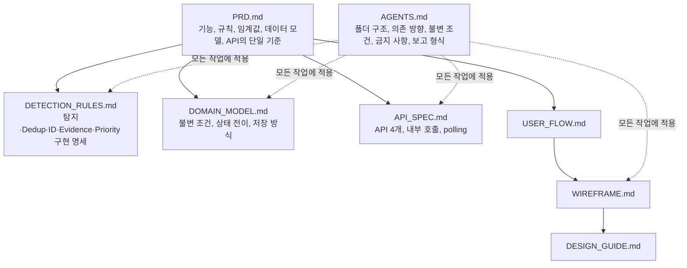
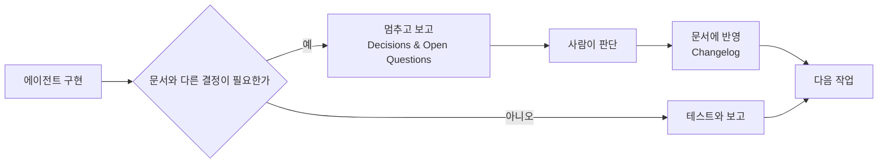

# 에이전트로 만든 방법

이 프로젝트는 사람이 문서를 쓰고 판단하고, AI 코딩 에이전트(Claude Code, Codex)가 구현과 테스트를 맡는 방식으로 3일 MVP를 만들었다.
이 문서는 그 방식을 정리한다. README의 "에이전트로 만든 방법"은 이 문서의 요약이다.

## 1. 문서 체계

에이전트는 매 작업을 시작할 때 `AGENTS.md`와 `docs/PRD.md`를 먼저 읽는다. 문서끼리 내용이 다르면 PRD를 따른다.

| 문서 | 에이전트가 이 문서에서 얻는 것 |
|---|---|
| `docs/PRD.md` | 무엇을 만드는지, 임계값과 점수표, 데이터 모델. "Must / Should / Won't"로 범위를 자른다 |
| `docs/DETECTION_RULES.md` | 탐지 규칙의 의사코드, 상수표, Fixture 기대 결과, 단위 테스트 목록 |
| `docs/DOMAIN_MODEL.md` | 엔티티별 불변 조건(I-, S-, T-, A- 번호). 코드로 옮겨 `assertInspectionInvariants`가 검사한다 |
| `docs/API_SPEC.md` | 요청·응답 형식, 오류 코드와 HTTP Status, `after()`와 내부 호출 규칙 |
| `docs/USER_FLOW.md` → `WIREFRAME.md` → `DESIGN_GUIDE.md` | 화면 흐름, 화면 구조, 색·타이포·간격 토큰 |
| `AGENTS.md` | 기술 스택, 폴더별 책임과 import 방향, 절대 지켜야 할 불변 조건 7개, 브라우저·보안 규칙, 작업 보고 형식 |

`AGENTS.md`의 불변 조건이 이 프로젝트의 뼈대다. 예를 들어 "측정값, Issue ID, Selector, Priority, 태스크 그룹 구성은 코드만 결정한다", "탐지·우선순위·태스크·프롬프트 코드에서 `Math.random`, 현재 시각, AI 호출을 쓰지 않는다" 같은 규칙은 에이전트가 편한 길(LLM에게 맡기기)로 가지 못하게 막는다.

## 2. 작업 분할과 게이트

작업은 T01~T15로 나눴다. 한 작업은 한 PR이고, 새 에이전트 세션에서 시작한다.

| 작업 | 내용 | 담당 |
|---|---|---|
| T01 | 초기 세팅, Vercel·Redis·Blob 연결 | 사람 |
| **T02** 🚧 | 서버리스 Chromium 실행 검증 (한글 폰트, Mobile 에뮬레이션) | 에이전트 → 사람이 preview에서 확인 |
| T03 | Fixture 페이지 15종(Positive 6, Negative 9)과 기대 결과 | 에이전트 |
| T04 | 렌더링 안정화와 측정 데이터 수집 | 에이전트 |
| T05 | 탐지 규칙 3종 | 에이전트 |
| **T06** 🚧 | Dedup, 병합, Priority, 이슈 수 상한, ID, `pnpm test:fixtures` | 에이전트 |
| T07 | Evidence 문장, 이슈 제목, cropRect | 에이전트 |
| T08 | URL 검증과 SSRF 차단 | 에이전트 |
| **T09** 🚧 | Job 파이프라인과 API (Redis, Blob, `after()`, polling) | 에이전트 → 사람이 preview에서 확인 |
| T10 | 규칙 기반 원인 분석, 태스크, 프롬프트 | 에이전트 |
| T11~T12 | UI: Home, Progress, 결과 화면, Issue Detail, 개발 태스크 | 에이전트 |
| T13 | 배포 마무리, 샘플 리포트, 오류 화면 | 에이전트 + 사람 |
| T14 | Before/After 사례와 README | 에이전트 + 사람 |
| T15 | AI 원인 분석 연동 | 후순위 (로드맵) |

🚧 게이트는 통과해야 다음 작업으로 넘어가는 지점이다.

- **Vercel 실행 검증(T02):** 서버리스 Chromium이 Vercel에서 뜨고 한글이 제대로 렌더링되는지를 가장 먼저 확인했다. 실패하면 Puppeteer로 바꾸는 대체 경로를 문서에 미리 적어 두었다.
- **Fixture 테스트(T06):** Positive 6/6, Negative 오탐 0/9, 두 번 실행한 결과가 같을 것, 그리고 `git diff tests/fixtures/expected.ts public/fixtures`에 변경이 없을 것. 에이전트가 테스트를 통과시키려고 기대값을 바꾸지 못하게 하는 조건이다.
- **파이프라인 배포 확인(T09):** preview 배포에서 Fixture URL을 검사해 `completed`까지 가는지, 내부 주소가 막히는지, 동시 요청 3개 중 1개가 `429`인지 사람이 직접 확인했다.

## 3. 피드백 순환

에이전트는 작업이 끝나면 Summary / Changed Files / Verification / Decisions & Open Questions 형식으로 보고한다. 문서와 다른 결정을 했거나 문서에 없는 값을 정했으면 "Decisions"에 적는다. 사람은 그것을 받아들일지 정하고, 받아들이면 다음 작업 전에 문서에 반영한다. 문서 맨 위의 Changelog가 그 기록이다.

실제 사례:

1. **판정 기준 크기에서 `innerWidth` 제외 (T04, DETECTION_RULES 3.1.1)**
   처음 문서는 `innerWidth`로 화면 이탈을 판정했다. 수집을 구현하던 에이전트가 Mobile 에뮬레이션에서 콘텐츠가 넘치면 Chromium이 페이지를 축소해 `innerWidth`가 커진다는 것을 측정했다(P-01: 616×1334). 같은 기기인데 페이지 내용에 따라 기준이 바뀌는 셈이다. 판정에는 `layoutWidth`와 설정 viewport 크기를 쓰고, cropRect는 실제 스크린샷 크기를 쓰도록 PRD, DETECTION_RULES, DOMAIN_MODEL을 함께 고쳤다(커밋 `aa21caf`).
2. **겹침 이슈 묶기와 이슈 수 상한 (T05, PRD 5.3.3·5.3.7)**
   처음 규칙은 겹치는 요소 쌍마다 이슈를 만들었다. 요소 하나가 여러 요소와 겹치면 이슈가 쌍의 수만큼 늘어난다. 이슈를 `(viewport, 대상 요소, subtype)`마다 하나로 묶고 상대 요소는 최대 5개만 남기도록 바꿨다. 그래도 많이 남는 경우를 막는 안전장치로 검사 1회당 이슈 200개 상한과 `issuesDetected`/`issuesTruncated` 필드를 추가하고, 처리 순서를 "병합 → Priority → 상한 → ID"로 바꿨다(커밋 `c35a722`).
3. **리다이렉트를 hop마다 검사 (T08, PRD 8.6)**
   SSRF 차단을 `context.route`로 구현하던 중, Playwright route가 리다이렉트의 다음 URL을 다시 가로채지 않는다는 것을 통합 테스트로 확인했다. 공개 주소가 내부 주소로 리다이렉트하면 검사를 건너뛰게 된다. 리다이렉트를 브라우저에 맡기지 않고 서버가 hop마다 검사하며 대신 요청하도록 바꾸고, 이 방식 때문에 생기는 한계(서버 경유 요청)를 PRD 10장에 적었다(커밋 `4e48f80`).
4. **규칙 기반 원인 분석으로 전환 (T10, PRD 5.7.1)**
   처음 계획은 AI가 원인을 분석하는 것이었다. 3일 일정에서 AI 연동을 먼저 하면 검사부터 프롬프트까지 이어지는 흐름 전체가 외부 API에 묶인다. 측정값과 `computedStyle`로 원인 후보를 고르는 규칙 표(DETECTION_RULES 13.1)를 먼저 만들고, AI는 같은 자리(`analyzeIssues`)를 바꾸는 후순위 작업(T15)으로 분리했다. 결과 화면과 프롬프트에는 "rule-based"라고 출처를 표시한다(커밋 `8a3776e`).
5. **viewport마다 브라우저를 새로 실행 (T13 이후 수정, AGENTS.md 7장)**
   production에서 Mobile 검사만 항상 180초 동안 멈췄다. `@sparticuz/chromium`은 `--single-process`로 실행되어 브라우저 하나에 context를 하나만 쓸 수 있고, 첫 context를 닫으면 브라우저가 죽거나 멈춘다. 에이전트가 로컬에서 같은 증상을 재현했고, viewport마다 브라우저를 띄웠다 닫는 구조와 단계별 강제 시간 제한을 넣었다. 이 규칙은 `src/`, `tests/`, `scripts/` 모두에 적용하도록 AGENTS.md에 적었다(커밋 `fcdcbcc`).

## 4. 역할 분담

| 사람 | 에이전트 |
|---|---|
| 문서 작성과 수정 결정 | 문서 기준의 구현 |
| 프로젝트 생성, 외부 서비스(Vercel, Upstash, Blob) 설정, 환경변수 | 단위 테스트, Fixture 테스트, 보안 통합 테스트 작성과 실행 |
| 배포와 배포 환경 확인 (게이트) | 문서와 다른 결정이 필요하면 멈추고 보고 |
| 에이전트 보고서의 Decisions 검토 | 로컬 도구(수집 결과 출력, 화면 스크린샷, 샘플 가져오기) 작성 |

에이전트는 배포 명령을 실행하지 않는다. 비밀 값은 에이전트가 보지 않고, `.env.example`에는 이름만 둔다.

## 5. 에이전트가 지키게 한 장치

- **Fixture 기대값 잠금:** `tests/fixtures/expected.ts`와 `public/fixtures/`는 테스트를 통과시키려고 바꾸지 않는다. 기대값이 틀렸다고 판단되면 근거를 보고하고 사람의 확인을 받는다.
- **불변 조건 검사:** DOMAIN_MODEL 3장의 조건을 `assertInspectionInvariants`로 옮겨 Fixture 테스트, 샘플 리포트, 사례 리포트에 모두 적용한다.
- **결정성 확인:** `pnpm test:fixtures --repeat 2`로 같은 입력에 같은 이슈, 태스크, 프롬프트가 나오는지 확인한다.
- **의존 방향:** `features/`와 `components/`는 `server/`를 import하지 않는다. 화면 코드가 서버 로직에 기대지 못하게 한다.
- **작업 보고 형식:** 무엇을 했는지(PRD 섹션 번호 포함), 바뀐 파일, 검증 결과, PRD에 없던 결정을 매번 같은 형식으로 남긴다.
