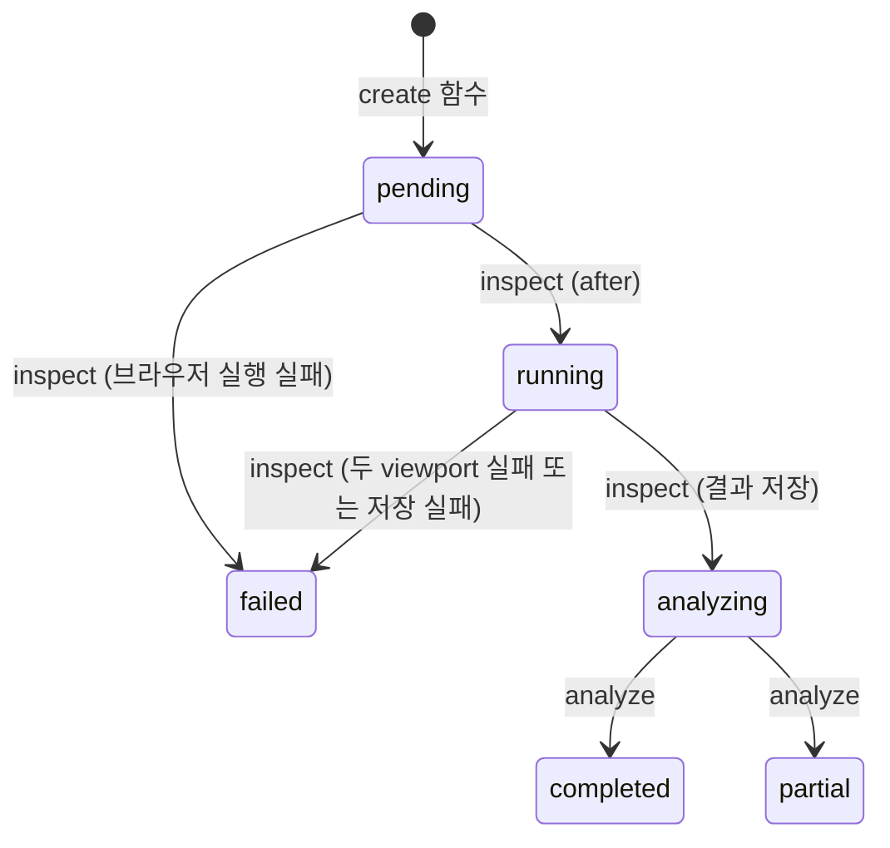

# AI Website Inspector — Domain Model

> Version: 2.0
> Status: Draft
> Related Documents: PRD.md (v1.2), DETECTION_RULES.md (v2.0), AGENTS.md

### Changelog (v1.0 → v2.0)

v1.0은 서버 메모리 저장, UUID 기반 Issue ID, 별도 Evidence·Prompt·AIAnalysis 엔티티를 전제로 해서 PRD v1.2와 Vercel 실행 환경에 맞지 않았다. v2.0은 PRD 8.2 데이터 모델을 기준으로 다시 썼다.

- 삭제: 서버 메모리 저장, `queued` 상태, `critical/high/medium/low` Priority, 4단계 Severity, `ruleId`/`ruleVersion`, Issue와 Task의 UUID, 별도 Evidence 엔티티, Prompt 버전과 target, AI 분석 이력, Task 상태, "viewport 하나만 실패해도 전체 failed" 규칙, `src/domain/` 폴더
- 추가: 엔티티별 불변 조건, 상태 전이와 쓰기 주체, Redis 키와 쓰기 방식, 스키마 위치와 import 규칙, 검증 경계

> **우선순위:** 타입의 정의는 PRD 8.2와 `src/types/inspection.ts`다. 이 문서는 타입을 다시 정의하지 않고, 그 타입이 지켜야 할 규칙과 저장 방식을 정한다.

---

## 1. Overview

### 1.1 Purpose

검사 결과 데이터의 구조, 불변 조건, 상태 전이, 저장 방식, 런타임 검증 위치를 정의한다.

### 1.2 Principles

1. **PRD 8.2가 단일 기준이다.** 타입은 `src/types/inspection.ts`에 PRD 8.2 그대로 직접 작성한다. zod 스키마는 이 타입을 따르도록 만든다(5장).
2. **하나의 Inspection이 하나의 문서다.** Issue, Task, AI 분석, 프롬프트는 모두 Inspection 안에 들어 있다. 별도 테이블이나 엔티티 저장소를 두지 않는다.
3. **결정적인 값과 비결정적인 값을 나눈다.** Issue ID, Task ID, 측정값, Priority, 태스크 구성은 코드가 같은 입력에서 항상 같게 만든다. Inspection ID, 시각, AI 문장만 실행마다 달라질 수 있다.
4. **함수 메모리에 상태를 두지 않는다.** 상태는 Redis, 이미지는 Blob에만 둔다(AGENTS.md 13장).
5. **데이터베이스를 쓰지 않는다.** `docs/future/DATA_MODEL.md`는 MVP 이후 참고용이다.

---

## 2. Entities

### 2.1 구성

```text
Inspection (Redis 문서 1개, 집합의 루트)
├── viewports: { desktop: ViewportResult | null, mobile: ViewportResult | null }
├── viewportErrors: { desktop: Error | null, mobile: Error | null }
├── analysis: { status, analyzedIssueCount, error? }
├── issues: Issue[]
│    ├── occurrences: IssueOccurrence[]     (Evidence, Source Hints, cropRect 포함)
│    └── analysis?                          (AI 원인 분석)
└── tasks: DevTask[]
     └── prompt                             (코드가 조립한 Markdown)
```

| v1.0 엔티티 | v2.0 위치 |
|---|---|
| Evidence | `IssueOccurrence`의 `measured`, `expected`, `delta`, `evidenceText`, `relatedElements` |
| ScreenshotArtifact | `ViewportResult.screenshotUrl`, `screenshotWidth`, `screenshotHeight` |
| AIAnalysis | `Issue.analysis` (이슈당 최대 1개, 이력 없음) |
| Prompt | `DevTask.prompt` (태스크당 1개, 버전 없음) |

### 2.2 ID

| 대상 | 형식 | 만드는 곳 | 결정적 |
|---|---|---|---|
| Inspection | `crypto.randomUUID()` | create 함수 | 아니오 |
| Issue | `ISS-001`, `ISS-002`, … | `src/server/detect/order.ts` (DETECTION_RULES 7.4) | 예 |
| DevTask | `TASK-001`, … | `src/server/tasks/group.ts` (PRD 5.8.1) | 예 |

- Inspection ID는 공유 URL에 들어가므로 추측할 수 없는 값이어야 한다. 새 의존성 없이 Node 내장 `crypto.randomUUID()`를 쓴다.
- Issue ID와 Task ID는 한 Inspection 안에서만 유일하다. 다른 Inspection의 `ISS-001`과는 관계가 없다.

### 2.3 시각

- 모든 시각은 서버가 만든 ISO 8601 UTC 문자열이다(예: `2026-11-13T08:20:00.000Z`).
- `createdAt`, `startedAt`, `completedAt`, `updatedAt`만 있다. Issue와 Task에는 시각이 없다. 같은 측정 데이터가 같은 이슈 목록을 만드는지 비교할 때 방해가 되기 때문이다.
- 탐지, 우선순위, 그룹화 코드는 시각을 읽지 않는다.

---

## 3. 불변 조건

`src/server/store/invariants.ts`의 `assertInspectionInvariants(inspection)`가 아래 조건을 검사한다. 단위 테스트, Fixture 테스트, 샘플 리포트 검증에서 실행한다. 운영 중 저장할 때는 실행하지 않는다. 코드 버그 하나로 정상적인 검사 결과 전체가 실패 처리되지 않게 하기 위해서다.

### 3.1 Inspection

| # | 조건 |
|---|---|
| I-1 | `status`는 PRD 6.2.1의 6개 값 중 하나다. |
| I-2 | `status = failed`이면 `error`가 있다. 그 밖의 상태에서는 `error`가 없다. |
| I-3 | `pending`, `running`에서는 `issues`와 `tasks`가 비어 있고 `viewports`가 모두 `null`이다. |
| I-4 | `analyzing`, `completed`, `partial`에서는 `viewports` 중 하나 이상이 `null`이 아니다. |
| I-5 | 브라우저 단계가 끝난 뒤(`analyzing` 이후, 또는 `failed`)에는 각 viewport에 대해 `viewports[v]`와 `viewportErrors[v]` 중 정확히 하나만 `null`이 아니다. 단, 렌더링 전에 실패한 `failed`는 둘 다 `null`일 수 있다. |
| I-6 | `completed`이면 `viewportErrors`가 모두 `null`이고 `analysis.status`는 `completed` 또는 `skipped`다. |
| I-7 | `partial`이면 `viewportErrors`에 `null`이 아닌 값이 있거나 `analysis.status = failed`다. |
| I-8 | `completed`, `partial`, `failed`이면 `completedAt`이 있다. |
| I-9 | `issues.length = 0`이고 브라우저 단계가 끝났으면 `analysis.status`는 `skipped`이고 `tasks`는 비어 있다. |
| I-10 | `analysis.error`가 있으면 `analysis.status = failed`이고 `error.code = AI_FAILED`다. |
| I-11 | `issues.length ≤ MAX_ISSUES(200)`, `issuesDetected ≥ issues.length`, `issuesTruncated = issuesDetected > issues.length`다(PRD 5.3.7). `pending`, `running`에서는 `issuesDetected = 0`이다. |

### 3.2 ViewportResult

| # | 조건 |
|---|---|
| V-1 | `width`, `height`는 PRD 5.2.1 설정값과 같다(Desktop 1440×900, Mobile 390×844). |
| V-2 | `screenshotHeight ≤ SCREENSHOT_MAX_HEIGHT[viewport]`, `screenshotTruncated = documentHeight > screenshotHeight` |
| V-3 | `elementsTruncated`이면 `elementsInspected = MAX_CANDIDATES`다. |

### 3.3 Issue

| # | 조건 |
|---|---|
| S-1 | `issues`는 ID 순서로 저장되고, ID는 `ISS-001`부터 빈 번호 없이 이어진다. ID는 상한(PRD 5.3.7)을 적용한 뒤 남은 이슈에만 붙인다. |
| S-2 | `occurrences`는 1개 또는 2개이고, 2개면 `[desktop, mobile]` 순서다. |
| S-3 | `viewports`는 `occurrences`의 viewport 목록과 같다. 실패한 viewport는 들어가지 않는다. |
| S-4 | `viewportTag`: 한 viewport가 실패했으면 `null`, 아니면 occurrence 2개 → `both`, 1개 → `desktop-only`/`mobile-only` |
| S-5 | `selector`, `sourceHints`는 `occurrences[0]`의 값과 같다. |
| S-6 | `relatedIssueIds`의 ID는 모두 존재하고, 자기 자신을 가리키지 않고, 대칭이며, 오름차순이다. |
| S-7 | `scores.score100 = S×35 + I×35 + R×30`이고, `priority`는 PRD 5.5.2 경계와 맞는다. `1 ≤ S, I, R ≤ 5` |
| S-8 | `confidence = min(occurrences[].confidence)`, `needsReview = confidence < 0.5` |
| S-9 | `needsReview`이면 `analysis`가 없고 `analysisSkippedReason = needs-review`다. |
| S-10 | `analysis`와 `analysisSkippedReason` 중 최대 하나만 있다. AI 단계가 끝난 뒤에는 정확히 하나가 있다. |
| S-11 | `cropRect`가 있으면 해당 viewport의 `[0, screenshotWidth] × [0, screenshotHeight]` 안에 있다. |
| S-12 | `type`과 `subtype` 조합은 DETECTION_RULES 1.1 표에 있는 것만 허용한다. |
| S-13 | `element-overlap` occurrence의 `relatedElements`는 1~5개이고 모두 `role = overlap-target`이며, `measured.overlapTargetCount ≥ relatedElements.length`다(DETECTION_RULES 5.6). |

### 3.4 DevTask

| # | 조건 |
|---|---|
| T-1 | `needsReview = false`인 이슈는 `needsReview = false`인 태스크 정확히 하나에 속한다. |
| T-2 | `needsReview = true`인 이슈는 `needsReview = true`인 태스크 정확히 하나에 속한다. |
| T-3 | 태스크의 `issueIds`는 1개 이상 8개 이하이고, 모두 존재하는 ID이며, 오름차순이다. |
| T-4 | `priority`는 포함된 이슈 중 가장 높은 Priority다. |
| T-5 | `tasks`는 ID 순서로 저장되고 `TASK-001`부터 이어진다. 정렬은 PRD 5.8.1 5번 규칙과 맞는다. |
| T-6 | `needsReview = true`인 태스크는 `titleSource = template`이다. |
| T-7 | `acceptanceCriteria`는 1개 이상이다. |
| T-8 | `prompt`는 비어 있지 않고, 포함된 모든 Issue ID를 담고 있다. |

---

## 4. 상태 전이와 쓰기 주체

### 4.1 전이



`completed`, `partial`, `failed`는 종료 상태다(PRD 6.2.1).

### 4.2 단계별 쓰기 주체

| 단계 | 쓰는 함수 | 바꾸는 필드 |
|---|---|---|
| 생성 | `POST /api/inspections` | 문서 전체 생성 (`pending`) |
| 브라우저 검사 | create 함수의 `after()` → `src/server/inspect.ts` | `status`, `step`, `startedAt`, `finalUrl`, `viewports`, `viewportErrors`, `issues`(AI 필드 제외), `error`, `completedAt`(failed일 때) |
| AI 단계 | `POST /api/inspections/:id/analyze`의 `after()` | `status`, `step`, `analysis`, `issues[].analysis`, `issues[].analysisSkippedReason`, `tasks`, `completedAt` |

- 한 시점에 문서를 쓰는 함수는 하나뿐이다. 브라우저 검사가 `analyzing`을 저장한 뒤에야 analyze가 시작되기 때문이다.
- analyze가 중복 호출되는 경우를 막기 위해 analyze 잠금(6.1)을 먼저 잡는다. 잠금을 잡지 못하면 409를 반환한다.
- 모든 쓰기는 `updatedAt`을 갱신한다.
- AI 단계는 `issues`의 결정적 필드(측정값, ID, Priority)를 바꾸지 않는다(AGENTS.md 불변 조건 1).

### 4.3 AI 단계의 기록 순서

1. `analysis.status = running`, `step = analyzing_issues` 저장
2. 이슈별 AI 분석 결과를 메모리에서 모은다.
3. 태스크 그룹화(코드) → 태스크 제목과 설명(AI) → Acceptance Criteria와 프롬프트(코드), `step = generating_tasks`
4. 최종 상태(6.2.2)와 함께 한 번에 저장

중간에 함수가 죽으면 문서는 `analyzing` + `analysis.status = running`으로 남는다. 이 상태는 GET 조회에서 처리한다(4.4).

### 4.4 멈춘 검사 처리

함수가 시간 제한이나 오류로 죽으면 문서가 종료 상태가 되지 못하고 남는다. GET 조회가 다음 규칙으로 화면에 보여줄 상태를 정한다. Redis에는 다시 쓰지 않는다.

| 저장된 상태 | 조건 | 응답 상태 |
|---|---|---|
| `pending`, `running` | `createdAt`에서 300초 이상 지남 | `failed`, `error.code = TIME_BUDGET_EXCEEDED` |
| `analyzing` | `updatedAt`에서 300초 이상 지남 | `partial`, `analysis.status = failed`, `analysis.error.code = AI_FAILED` |

300초는 함수 `maxDuration`과 같은 값이다. 이 규칙은 `src/server/store/redis.ts`의 읽기 함수 한 곳에만 둔다. 화면이 영원히 진행 중으로 남지 않게 하기 위해서다.

---

## 5. 스키마 위치와 import 규칙

### 5.1 위치

| 위치 | 내용 | 런타임 코드 |
|---|---|---|
| `src/types/inspection.ts` | PRD 8.2 타입. 단일 기준 | 없음 |
| `src/types/api.ts` | API 요청·응답 타입 | 없음 |
| `src/schemas/` | **클라이언트와 서버가 함께 쓰는 zod 스키마만** | zod |
| `src/server/**/schemas.ts` | 서버에서만 쓰는 zod 스키마 | zod |

`src/schemas/`에 두는 것 (MVP 기준):

| 파일 | 내용 | 쓰는 곳 |
|---|---|---|
| `src/schemas/inspectionRequest.ts` | `POST /api/inspections` 요청 본문: `z.strictObject({ url: z.string().trim().min(1).max(2048) })` | `features/inspection-form`(형식 확인), `app/api/inspections/route.ts`(본문 파싱) |
| `src/schemas/enums.ts` | `Priority`, `IssueType`, `ViewportTag`, `InspectionStatus`, `ErrorCode`의 `z.enum` | 필터 UI의 옵션 목록, 서버 스키마 조립 |

`src/server/`에 두는 것:

| 파일 | 내용 |
|---|---|
| `src/server/env.ts` | 환경변수 (AGENTS.md 5장) |
| `src/server/store/schemas.ts` | Redis에서 읽은 Inspection 문서 전체 검증 |
| `src/server/ai/schemas.ts` | AI 출력 (PRD 5.7.3) |
| `src/server/collect/schemas.ts` | `page.evaluate` 반환값 검증 (브라우저에서 넘어온 값도 외부 입력이다) |

- URL의 형식 확인은 `src/schemas/inspectionRequest.ts`가 하지만, 허용 여부(프로토콜, 계정 정보, 금지된 대상)의 실제 판정은 항상 `src/server/security/url.ts`다(AGENTS.md 3.1).
- 함께 쓰는 스키마가 아니면 `src/schemas/`에 넣지 않는다. 처음에는 서버에 두고, 클라이언트도 필요해질 때 옮긴다.

### 5.2 import 규칙

| 폴더 | import 가능 |
|---|---|
| `src/schemas/` | `src/types/`, `zod` |
| `src/types/` | 없음 (타입 전용) |

`features/`, `components/`, `server/`, `app/`은 `src/schemas/`를 import할 수 있다. 이 규칙은 AGENTS.md 3.1 표에 추가한다.

### 5.3 타입과 스키마를 맞추는 방법

타입은 직접 작성하고, 스키마는 그 타입에 맞는지 컴파일 시점에 확인한다.

```ts
// src/server/store/schemas.ts
import type { Inspection } from '@/types/inspection';

export const inspectionSchema = z.strictObject({ /* … */ }) satisfies z.ZodType<Inspection>;
```

- 타입과 스키마가 어긋나면 `pnpm typecheck`가 실패한다.
- 스키마에서 타입을 추론(`z.infer`)해서 쓰지 않는다. PRD 8.2와 `src/types/inspection.ts`를 단일 기준으로 유지하기 위해서다.

### 5.4 zod v4 표기

설치된 zod는 v4다. 다음 표기를 쓴다.

| 쓰지 않음 (deprecated) | 사용 |
|---|---|
| `z.string().uuid()` | `z.uuid()` |
| `z.string().datetime()` | `z.iso.datetime()` |
| `z.object({…}).strict()` | `z.strictObject({…})` |
| `z.number().finite()` | `z.number()` (v4는 기본으로 Infinity를 거부한다) |

---

## 6. 저장 방식

### 6.1 Redis (Upstash)

| 키 | 값 | TTL | 용도 |
|---|---|---|---|
| `inspection:{id}` | Inspection JSON 문자열 | 7일 | 검사 문서 (PRD 8.1.4) |
| `inspections:running` | Sorted Set (member = id, score = 만료 시각 ms) | 없음 (member별 만료) | 동시 실행 슬롯 (PRD 8.4) |
| `inspection:{id}:analyze-lock` | `"1"` | 300초 | analyze 중복 실행 방지 |

쓰기 방식:
- 생성: `SET inspection:{id} … EX 604800`
- 이후 갱신: 문서 전체를 다시 쓴다. `SET … KEEPTTL`로 처음 TTL을 유지한다. 부분 갱신을 쓰지 않는 이유는 한 시점에 쓰는 함수가 하나뿐이라(4.2) 충돌이 없고, 문서가 작기 때문이다.
- analyze 잠금: `SET inspection:{id}:analyze-lock 1 NX EX 300`
- 슬롯: Lua 스크립트 하나로 만료 member 제거 → 개수 확인 → 추가(PRD 8.4). 반환은 `finally`에서 `ZREM`.

읽기 방식:
- `GET inspection:{id}` → `JSON.parse` → `inspectionSchema.parse` → 멈춘 검사 처리(4.4)
- 키가 없으면 404. 스키마 검증에 실패하면 500(`INTERNAL_ERROR`)으로 응답하고 로그에는 검사 ID만 남긴다.

크기: 이슈 수백 개 기준으로 문서는 수백 KB 수준이다. API 응답 한도(4.5MB)와 Upstash 요청 한도 안에 들어가는지 큰 페이지로 한 번 확인한다.

### 6.2 Blob (Vercel Blob)

| 경로 | 내용 |
|---|---|
| `inspections/{id}/desktop-full.png` | Desktop 전체 스크린샷 |
| `inspections/{id}/mobile-full.png` | Mobile 전체 스크린샷 |

- 크롭 이미지는 만들지 않는다(PRD 5.4.1).
- 업로드할 때 `addRandomSuffix`를 켠다. Blob URL은 공개 URL이므로, 검사 ID를 아는 사람만 이미지 주소를 알 수 있게 하기 위해서다.
- 7일이 지난 파일 정리는 Should다(PRD 8.1.4).

### 6.3 샘플 리포트

| 파일 | 내용 |
|---|---|
| `public/sample/inspection.json` | 완료된 Inspection 문서 하나 (`status: completed`) |
| `public/sample/desktop-full.png`, `public/sample/mobile-full.png` | 스크린샷. JSON의 `screenshotUrl`은 `/sample/…` 상대 경로 |

- `/report/sample` 페이지가 이 JSON을 import해 같은 결과 화면 컴포넌트로 렌더링한다.
- 단위 테스트에서 `inspectionSchema.parse`와 `assertInspectionInvariants`를 통과해야 한다.
- 만드는 방법: 배포 환경에서 Fixture 또는 데모 페이지를 검사한 뒤, 결과 JSON과 스크린샷을 내려받아 저장소에 넣는다. 외부 실제 사이트의 결과는 넣지 않는다.

---

## 7. 검증 경계

| 경계 | 검증 | 실패 시 |
|---|---|---|
| 사용자 → API 요청 본문 | `src/schemas/inspectionRequest.ts` + `src/server/security/url.ts` | 400 `INVALID_URL` / `BLOCKED_TARGET` |
| 내부 호출 → `/analyze` | 공유 비밀 헤더 | 401 |
| 브라우저 → `page.evaluate` 반환값 | `src/server/collect/schemas.ts` | 해당 viewport `DETECTION_FAILED` |
| AI 응답 | `src/server/ai/schemas.ts` + 입력에 없는 ID 버림 | 1회 재시도 후 "AI 분석 없음" (PRD 5.7.4) |
| Redis → 서버 | `src/server/store/schemas.ts` | 500 `INTERNAL_ERROR` |
| 환경변수 | `src/server/env.ts` (용도별 getter) | getter를 처음 호출할 때 오류. import 시점에는 검증하지 않는다(AGENTS.md 5장) |
| 서버 → 클라이언트 응답 | 검증하지 않음 (같은 타입을 공유) | — |
| 탐지 결과 → 저장 | 운영 중 검증하지 않음. 테스트에서 `assertInspectionInvariants` | — |

---

## 8. API 응답과의 관계

- `GET /api/inspections/:id`는 저장된 Inspection 문서를 멈춘 검사 처리(4.4)만 거쳐 그대로 돌려준다. 별도 DTO 변환을 두지 않는다(PRD 8.3).
- 응답에 비밀 값이 들어갈 필드가 없다. 서버 내부 정보(스택 트레이스, 내부 경로)는 처음부터 문서에 저장하지 않는다. `error.message`는 사용자에게 보여줄 문구만 담는다.
- 이 응답은 공유 URL로 누구나 볼 수 있다. 검사 대상 URL, 페이지 텍스트 일부(textSnippet, htmlSnippet), 스크린샷이 포함된다는 점을 Known Limitations나 화면 안내에서 알린다.

---

## 9. 이 문서에서 새로 정한 값과 규칙

PRD에 없던 결정이다(AGENTS.md 6장).

1. Inspection ID는 `crypto.randomUUID()`를 쓴다(2.2).
2. 불변 조건 검사는 테스트에서만 실행하고 운영 저장 때는 실행하지 않는다(3장).
3. 함수가 죽어 멈춘 검사는 GET 조회 때 300초 기준으로 `failed`/`partial`로 보여준다. Redis에는 다시 쓰지 않는다(4.4).
4. analyze 중복 실행 방지용 Redis 잠금 키(6.1).
5. Redis 문서는 매번 전체를 다시 쓰고 `KEEPTTL`로 TTL을 유지한다(6.1).
6. 스키마 위치: 함께 쓰는 스키마만 `src/schemas/`, 나머지는 `src/server/`. 타입은 직접 작성하고 스키마는 `satisfies`로 맞춘다(5장).
7. `page.evaluate` 반환값도 zod로 검증한다(5.1, 7장).
8. Blob 업로드에 `addRandomSuffix`를 쓴다(6.2).
9. 샘플 리포트 파일 위치 `public/sample/`(6.3).
10. 공유 URL로 페이지 텍스트 일부와 스크린샷이 공개된다는 점을 안내한다(8장).
11. 새 파일: `src/server/store/invariants.ts`, `src/server/store/schemas.ts`, `src/server/collect/schemas.ts`, `src/schemas/inspectionRequest.ts`, `src/schemas/enums.ts`
12. 이슈 수 상한 관련 불변 조건 I-11, 겹침 이슈 묶기 관련 불변 조건 S-13을 추가했다(PRD 5.3.3, 5.3.7).

---

**Document Status:** Draft v2.0
**Next Step:** API_SPEC을 PRD v1.2 8.3과 이 문서 기준으로 다시 작성한다.