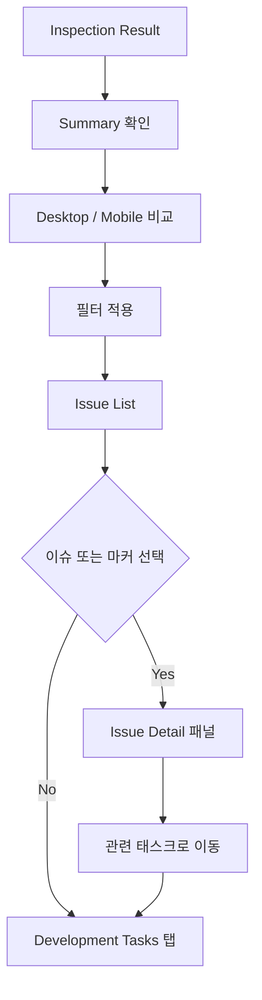
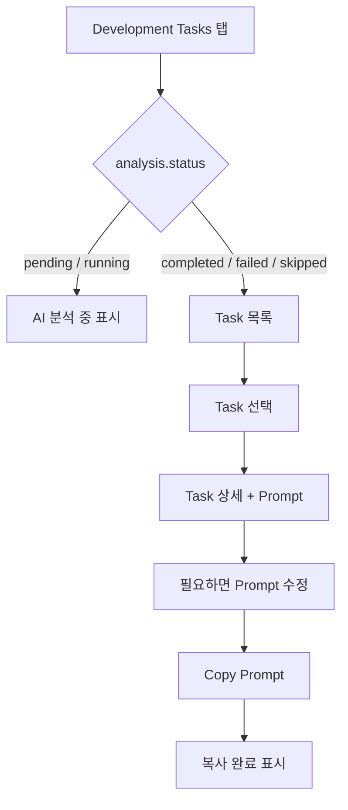

# AI Website Inspector — User Flow

> Version: 1.1
> Status: Draft
> Related Document: PRD.md (v1.2)

### Changelog (v1.0 → v1.1)

- PRD v1.2에 맞춰 화면 경로, 검사 단계, 상태, 실패 코드를 통일
- 이슈 상태 관리(Open/Ignored/Resolved), AI 재분석, 사용자 직접 태스크 구성 등 범위 밖 흐름 제거
- 태스크 그룹화와 프롬프트 구조를 PRD 5.8, 5.9 기준으로 수정
- Needs Review, 검사 범위 제한 안내, 동시 실행 초과(429), 결과 만료(404), 샘플 리포트, 공유 URL 흐름 추가
- Open Questions 확정

> PRD와 내용이 다르면 PRD를 따른다. 이 문서는 화면 사이의 이동과 사용자가 보는 상태를 정의한다. 탐지 규칙, 데이터 모델, API의 세부 내용은 PRD의 해당 절을 참조한다.

---

## 1. Overview

### 1.1 Purpose

본 문서는 AI Website Inspector의 전체 사용자 흐름과 화면 간 이동 구조를 정의한다.

사용자가 웹사이트 URL을 입력하고 UI 검사를 시작하는 순간부터 검사 결과를 확인하고, 개발 태스크와 AI Coding Prompt를 복사하는 과정까지 정의한다. 검사 과정에서 생길 수 있는 오류와 예외 상황의 사용자 경험도 함께 정의한다.

### 1.2 Core User Journey

1. 웹사이트 URL 입력
2. 검사 시작 (검사 환경은 Desktop 1440 / Mobile 390 고정)
3. 진행 상태 확인
4. 검사 결과 확인 (브라우저 검사 결과가 먼저 나오고, AI 분석은 이어서 채워진다)
5. 개별 이슈 상세 확인 (Evidence, Source Hints, AI 원인 분석)
6. Development Task 확인
7. AI Coding Prompt 복사

### 1.3 User Flow Principles

- 사용자는 URL 입력 한 번으로 검사를 시작할 수 있어야 한다.
- 검사 진행 상태를 명확하게 보여줘야 한다.
- 탐지된 문제와 실제 측정 증거를 연결해야 한다.
- 검사 실패(`failed`)와 일부 실패(`partial`)를 구분해야 한다.
- AI 분석이 실패하더라도 규칙 기반 검사 결과는 보존하고 보여줘야 한다.
- AI가 추론한 내용은 측정한 사실과 구분해서 보여줘야 한다.

---

## 2. Information Architecture

### 2.1 Main Screens

| Screen | Path | Purpose |
|---|---|---|
| Home | `/` | URL 입력 및 검사 시작 |
| Inspection Progress | `/inspections/[id]` | 브라우저 검사 진행 상태 확인 |
| Inspection Result | `/report/[id]` | 전체 검사 결과 확인 (공유 가능한 URL) |
| Issue Detail | `/report/[id]?issue=ISS-001` | 결과 화면 안의 상세 패널 |
| Development Tasks | `/report/[id]?tab=tasks&task=TASK-001` | 결과 화면 안의 태스크 탭 |
| Sample Report | `/report/sample` | 미리 검사해 둔 정적 샘플 리포트 |

- Issue Detail과 Development Tasks는 별도 페이지가 아니라 결과 화면 안의 패널과 탭으로 제공한다.
- 선택한 이슈와 탭은 query string에 반영한다. 그래서 새로고침하거나 URL을 공유해도 같은 화면이 열린다.

### 2.2 Main Navigation Structure

```text
Home
 ├── Sample Report (/report/sample)
 └── Start Inspection
      └── Inspection Progress (/inspections/[id])
           ├── Inspection Failed → Retry (Home으로 같은 URL을 채워서 이동)
           └── Inspection Result (/report/[id])
                ├── Desktop / Mobile Preview
                ├── Issue List
                │    ├── Needs Review (기본 접힘)
                │    └── Issue Detail (패널)
                └── Development Tasks (탭)
                     └── Prompt (textarea)
                          └── Copy Prompt
```

---

## 3. Flow 01 — Start Inspection

### 3.1 Goal

사용자가 검사할 웹사이트 URL을 입력하고 검사를 시작한다.

### 3.2 Entry Point

Home (`/`)

### 3.3 User Actions

1. 서비스에 접속한다.
2. 검사할 웹사이트 URL을 입력한다.
3. 검사 환경 안내(Desktop 1440×900 / Mobile 390×844)를 확인한다. 선택하거나 바꿀 수 없다.
4. Start Inspection 버튼을 클릭한다.

### 3.4 System Behavior

1. 클라이언트가 입력값의 형식을 먼저 확인한다(빈 값, URL 형식, 프로토콜). 입력 편의를 위한 검사이며, 실제 판정은 서버가 한다.
2. 서버(`POST /api/inspections`)가 URL 형식과 금지된 대상 여부를 검증한다(PRD 8.6).
3. 동시 실행 슬롯을 확인한다(PRD 8.4).
4. 검사 작업을 만들고 `202 { id }`를 돌려준다.
5. 클라이언트는 `/inspections/[id]`로 이동한다.

### 3.5 Flow Diagram

```mermaid
flowchart TD
    A[Home] --> B[Enter Website URL]
    B --> C[Click Start Inspection]
    C --> D{클라이언트 형식 확인}
    D -->|실패| E[입력창 아래 오류 표시]
    E --> B
    D -->|통과| F[POST /api/inspections]
    F --> G{서버 응답}
    G -->|400 INVALID_URL| E
    G -->|400 BLOCKED_TARGET| H[검사할 수 없는 주소 안내]
    H --> B
    G -->|429 TOO_MANY_INSPECTIONS| I[잠시 후 다시 시도 안내]
    I --> B
    G -->|202 id| J[/inspections/id 로 이동]
```

### 3.6 Validation Rules

| Condition | 판정 위치 | Expected Behavior |
|---|---|---|
| 빈 URL | 클라이언트 | "검사할 URL을 입력해 주세요." |
| URL 형식 오류 | 클라이언트 + 서버(`INVALID_URL`) | 올바른 URL 형식 안내 |
| HTTP/HTTPS가 아님 | 클라이언트 + 서버(`INVALID_URL`) | HTTP / HTTPS만 지원한다고 안내 |
| 계정 정보가 들어간 URL | 서버(`INVALID_URL`) | 계정 정보가 없는 URL을 입력하라고 안내 |
| localhost, 사설 IP, 메타데이터 주소 등 | 서버(`BLOCKED_TARGET`) | 보안상 검사할 수 없는 주소라고 안내 |
| 동시 실행 수 초과 | 서버(`TOO_MANY_INSPECTIONS`) | 다른 검사가 진행 중이니 잠시 후 다시 시도하라고 안내 |
| 공개 URL | 서버 | 검사 시작 |

- 리다이렉트로 금지된 대상에 도달하는 경우는 여기서 알 수 없다. 검사 중에 차단되고 진행 화면에서 안내한다(7.2).
- 입력 프로토콜이 없으면(`example.com`) 클라이언트가 `https://`를 붙여서 보낸다.

### 3.7 UI States

- Empty
- Focused
- Filled
- Invalid (오류 메시지 표시, 입력값 유지)
- Submitting (버튼 로딩, 중복 제출 방지)

### 3.8 Completion

검사 작업이 정상적으로 생성되면 Inspection Progress 화면으로 이동한다.

---

## 4. Flow 02 — Inspection Progress

### 4.1 Goal

사용자가 브라우저 검사 진행 상황을 확인한다.

### 4.2 Entry Point

검사 생성 직후, 또는 `/inspections/[id]` URL로 직접 접근

### 4.3 System Process

진행 단계는 PRD 6.2.3의 `step`을 그대로 표시한다.

| step | 화면 표시 |
|---|---|
| `initializing_browser` | 브라우저 준비 중 |
| `rendering_desktop` | Desktop 렌더링 및 측정 중 |
| `rendering_mobile` | Mobile 렌더링 및 측정 중 |
| `detecting_issues` | UI 문제 탐지 중 |
| `saving_results` | 검사 결과 저장 중 |
| `analyzing_issues` | AI 원인 분석 중 |
| `generating_tasks` | 개발 태스크와 프롬프트 생성 중 |

Desktop과 Mobile은 순서대로 실행된다. 스크린샷 캡처와 측정은 각 viewport 단계 안에서 함께 진행된다.

### 4.4 Flow Diagram

```mermaid
flowchart TD
    A[Progress 화면 진입] --> B[GET /api/inspections/id 즉시 조회]
    B --> C{status}
    C -->|pending / running| D[단계 표시 갱신, 2초 뒤 다시 조회]
    D --> B
    C -->|analyzing| E[/report/id 로 이동]
    C -->|completed / partial| E
    C -->|failed| F[실패 원인과 다시 시도 버튼]
    C -->|404| G[결과 없음 또는 만료 안내]
```

### 4.5 Progress UI

- 검사 대상 URL
- 단계 목록과 각 단계 상태(대기 / 진행 중 / 완료 / 실패)
- 경과 시간
- 실패하면 실패한 단계, 실패 원인, 다시 시도 버튼

### 4.6 Status Handling

| Status | UI Behavior |
|---|---|
| `pending` | "검사 대기 중" 표시 |
| `running` | 현재 `step` 강조, 완료된 단계 체크 |
| `analyzing` | 결과 화면(`/report/[id]`)으로 자동 이동 |
| `completed` | 결과 화면으로 자동 이동 |
| `partial` | 결과 화면으로 자동 이동 (결과 화면에서 일부 실패 안내) |
| `failed` | 실패 원인과 다시 시도 버튼 표시 |

### 4.7 Polling Rules

- 진입 즉시 한 번 조회하고, 이후 2초 간격으로 조회한다.
- 이전 요청이 끝나기 전에는 다음 요청을 보내지 않는다.
- 종료 상태(`completed`, `partial`, `failed`)나 `analyzing`이 되면 이 화면의 polling을 멈춘다.
- 네트워크 오류는 3회까지 다시 시도하고, 그래도 실패하면 "상태를 불러오지 못했습니다"와 새로고침 버튼을 보여준다.
- 페이지를 떠나면 polling을 멈춘다.

### 4.8 Important Behavior

- 검사 중 페이지를 새로고침해도 같은 검사 상태를 다시 볼 수 있어야 한다.
- 검사 결과가 준비되기 전에는 완료된 것처럼 표시하지 않는다.
- 브라우저 검사 결과가 저장되면(`analyzing`) AI 분석이 끝나기를 기다리지 않고 결과를 보여준다.

---

## 5. Flow 03 — Inspection Result

### 5.1 Goal

사용자가 전체 검사 결과를 한눈에 파악하고 문제가 발생한 위치를 확인한다.

### 5.2 Entry Point

- Progress 화면에서 자동 이동
- 공유받은 `/report/[id]` URL로 직접 접근

### 5.3 Screen Layout

```text
Inspection Result
│
├── Header
│    ├── 검사 대상 URL / 최종 URL
│    ├── 검사 시각
│    └── 상태 (AI 분석 중 / 완료 / 일부 실패)
│
├── 검사 범위 안내 (해당할 때만)
│    ├── 실패한 viewport
│    ├── 스크린샷 잘림, 요소 수 잘림, 이슈 수 잘림(상위 200개만 표시)
│    ├── canvas 영역 있음
│    ├── meta viewport 없음
│    └── AI 분석 실패 또는 일부 이슈 AI 분석 제외
│
├── Summary
│    ├── Total Issues
│    ├── P0 / P1 / P2 / P3
│    └── Desktop / Mobile Issue Count
│
├── Viewport Comparison
│    ├── Desktop Preview (이슈 마커)
│    └── Mobile Preview (이슈 마커)
│
├── 탭: Issues | Development Tasks
│
└── Issues 탭
     ├── Issue Filters (Priority / Category / Viewport 태그)
     ├── Issue List
     └── Needs Review (기본 접힘)
```

### 5.4 User Actions

1. 전체 문제 수와 우선순위를 확인한다.
2. Desktop / Mobile 미리보기를 비교한다.
3. Priority, Category, Viewport 태그로 필터링한다.
4. 특정 이슈를 클릭하거나 스크린샷 마커를 클릭해 Issue Detail 패널을 연다.
5. Development Tasks 탭으로 이동한다.

### 5.5 Flow Diagram



### 5.6 AI 분석 진행 중 (`analyzing`)

- 이슈 목록, 스크린샷, Evidence는 바로 보여준다.
- AI 원인 분석 영역과 Development Tasks 탭에는 "AI 분석 중" 상태를 표시한다.
- 이 화면은 2초 간격으로 polling을 계속하고, 종료 상태가 되면 멈춘다. 규칙은 4.7과 같다.

### 5.7 Filtering Behavior

| Filter | Options |
|---|---|
| Priority | 전체 / P0 / P1 / P2 / P3 |
| Category | 전체 / Text Overflow / Element Overlap / Viewport Overflow |
| Viewport | 전체 / `mobile-only` / `desktop-only` / `both` |

- 필터는 조합해서 사용할 수 있다.
- 한 viewport가 실패한 검사는 비교 태그가 없으므로(PRD 5.6) Viewport 필터를 숨긴다.
- 기본 정렬은 Priority(P0 → P3) → Issue ID 순이다.

### 5.8 Needs Review

- Confidence가 0.5 미만인 이슈는 목록 아래 `Needs Review` 그룹에 모은다. 기본으로 접혀 있다.
- 그룹 제목에 개수와 "의도된 디자인일 수 있는 항목"이라는 설명을 함께 표시한다.
- Summary의 Total과 Priority별 개수에는 Needs Review를 포함하지 않고, 따로 "검토 필요 N개"로 표시한다.

### 5.9 No Issue State

문제가 하나도 발견되지 않은 경우:

- 검사 완료 상태 표시
- "검사한 3가지 유형에서는 문제가 발견되지 않았습니다." 메시지
- Desktop / Mobile 스크린샷 제공
- 다른 유형의 문제가 없다는 뜻은 아니라는 안내

### 5.10 공유

- `/report/[id]` URL을 복사해 공유할 수 있다(PRD Should).
- 결과는 7일 동안 보관된다. 만료되면 7.6을 따른다.

---

## 6. Flow 04 — Issue Detail

### 6.1 Goal

사용자가 특정 UI 문제의 위치, 측정 증거, 원인, 수정 방향을 이해한다.

### 6.2 Entry Point

Issue List 항목 또는 스크린샷 마커 선택 (`?issue=ISS-001`)

### 6.3 Screen Structure

```text
Issue Detail (패널)
│
├── Issue Header
│    ├── Issue Title (코드가 생성)
│    ├── Priority, Category, Confidence
│    └── Viewport 태그
│
├── Evidence (viewport별 occurrence마다 반복)
│    ├── 하이라이트 스크린샷 (cropRect)
│    ├── Evidence 문장
│    ├── 측정값 표 (measured / expected / delta)
│    ├── Selector
│    └── 관련 요소
│
├── Source Hints
│    ├── Section (landmark)
│    ├── Text
│    ├── Attributes
│    └── HTML (문자열로만 표시)
│
├── AI Analysis
│    ├── Root Cause (certainty 배지)
│    └── Suggested Fix
│
└── Related Development Task
```

### 6.4 User Actions

1. 이슈를 선택한다.
2. 하이라이트 스크린샷으로 문제 위치를 확인한다.
3. Evidence 문장과 측정값을 확인한다.
4. Selector와 Source Hints를 확인한다.
5. AI 원인 분석과 수정 제안을 확인한다.
6. 관련 Development Task로 이동한다.

### 6.5 Evidence Display Rules

Evidence는 브라우저에서 측정한 값만 표시한다. 측정하지 않은 값은 만들어내지 않는다.

예시:

```text
Text Overflow · clipped — button "지금 무료로 시작하기"
P1 · Confidence 1.0 · mobile-only

Mobile (390 × 844)
내부 콘텐츠 너비(412px)가 컨테이너 너비(358px)를 54px 초과합니다. (overflow: hidden으로 잘림)

measured   scrollWidth  412
expected   clientWidth  358
delta      overflowX     54
Selector   [data-testid="hero-cta"]
```

- 대상 요소가 스크린샷 범위 밖이면 이미지 자리에 "스크린샷 범위 밖"을 표시한다.

### 6.6 AI Analysis Display Rules

다음 세 가지를 시각적으로 구분한다.

- 측정한 사실: Evidence와 수집한 CSS 정보
- 예상 원인: AI가 추론한 원인 (`certainty` 배지: confirmed / likely / uncertain)
- 수정 제안: AI가 제안한 수정 방향과 코드

AI 분석이 없을 때는 이유에 따라 다음 문구를 표시하고, Evidence는 그대로 보여준다.

| 이유 | 문구 |
|---|---|
| `analyzing` 진행 중 | AI 분석 중입니다. |
| Needs Review 이슈 | 검토 필요 항목은 AI 분석 대상이 아닙니다. |
| 분석 대상 수 초과 | 우선순위가 높은 30개 이슈만 AI가 분석합니다. |
| AI 실패 | AI 분석을 가져오지 못했습니다. Evidence와 Source Hints로 직접 확인해 주세요. |

---

## 7. Flow 05 — Development Tasks

### 7.1 Goal

관련된 여러 UI 문제를 하나의 개발 작업으로 정리하고, 코딩 에이전트용 프롬프트를 복사한다.

### 7.2 Entry Point

결과 화면의 Development Tasks 탭, 또는 Issue Detail의 관련 태스크 링크

### 7.3 System Behavior

태스크는 AI 분석 단계에서 미리 만들어진다. 사용자가 태스크를 만들거나 그룹을 바꾸지 않는다.

1. 코드가 PRD 5.8.1 규칙으로 이슈를 묶는다: 같은 viewport 태그 + 같은 landmark, `relatedIssueIds`로 연결된 이슈는 같은 그룹, 그룹당 최대 8개.
2. 태스크 Priority는 그룹 안에서 가장 높은 이슈의 Priority다.
3. AI가 태스크 제목과 문제 설명을 쓴다. 실패하면 코드 템플릿 제목을 쓴다.
4. 코드가 Acceptance Criteria와 프롬프트를 조립한다.
5. Needs Review 이슈는 일반 태스크에 들어가지 않고, 따로 묶인 Needs Review 태스크로 만들어진다.

### 7.4 Example

```text
TASK-001  모바일 Hero 영역 레이아웃 수정   [P0] [mobile-only]

Related Issues
- ISS-003 Viewport Overflow · page-scroll — div.hero-visual
- ISS-004 Text Overflow · clipped — button "지금 무료로 시작하기"

Problem
모바일 화면에서 Hero 영역의 이미지 박스가 화면 밖으로 나가 가로 스크롤이 생기고,
CTA 버튼의 텍스트가 잘립니다.

Acceptance Criteria
- 390px viewport에서 document.documentElement.scrollWidth가 390 이하이다.
- [data-testid="hero-cta"]의 scrollWidth가 clientWidth를 넘지 않는다.
- 1440px viewport의 레이아웃은 변경되지 않는다.
```

위 예시는 이해를 돕기 위한 것이며, 실제 내용은 검사 데이터와 AI 분석 결과에 따라 달라진다.

### 7.5 User Actions

1. Development Tasks 탭을 선택한다.
2. 태스크 목록(Priority 순)을 확인한다.
3. 태스크를 선택한다(`?task=TASK-001`).
4. 연결된 이슈, Root Cause, Suggested Fix, Acceptance Criteria를 확인한다.
5. 프롬프트를 확인하고 필요하면 수정한 뒤 복사한다.
6. 필요하면 "Needs Review 포함"을 켜서 Needs Review 태스크도 확인한다(PRD Should).

### 7.6 Flow Diagram



### 7.7 Important Rules

- Needs Review가 아닌 모든 이슈는 정확히 하나의 일반 태스크에 속한다.
- AI는 태스크에 이슈를 더하거나 빼지 않는다. 검사 결과에 없는 문제를 만들지 않는다.
- 관련 이슈가 없는 태스크는 만들지 않는다.
- AI 분석 단계 전체가 실패해도 태스크는 코드 템플릿 제목으로 만들어진다.
- 이슈가 0개면 "생성된 태스크가 없습니다"를 표시한다.

---

## 8. Flow 06 — AI Coding Prompt

### 8.1 Goal

사용자가 Development Task를 AI 코딩 에이전트에 바로 전달할 수 있게 한다.

### 8.2 Entry Point

Development Task 상세

### 8.3 Prompt Structure

프롬프트는 코드가 PRD 5.9.1 템플릿으로 조립한다. 구조는 다음과 같다.

```markdown
# Task: 모바일 Hero 영역 레이아웃 수정
Priority: P0 | Viewport: mobile-only

## Problem
모바일 화면에서 Hero 영역의 이미지 박스가 화면 밖으로 나가 가로 스크롤이 생깁니다.

## [ISS-003] Viewport Overflow · page-scroll — div.hero-visual

### Evidence (measured in browser)
- mobile (390×844): 요소의 오른쪽 끝(600px)이 Mobile 화면 너비(390px)를 210px 벗어나 페이지 가로 스크롤이 발생합니다.
  - Selector: `section#hero > div.hero-visual`

### How to locate the element in source
- Section: hero
- HTML: `<div class="hero-visual" style="width: 600px">`

### Likely Root Cause (likely)
고정 너비(width: 600px)가 모바일 화면보다 넓습니다.

### Required Changes
.hero-visual { width: 100%; max-width: 600px; }

## Constraints
- 다른 viewport(desktop)의 레이아웃을 깨뜨리지 않는다.
- 관련 없는 컴포넌트와 스타일은 수정하지 않는다.
- 위 Root Cause는 추정일 수 있으니, 소스 코드를 확인한 뒤 수정한다.

## Acceptance Criteria
- 390px viewport에서 `document.documentElement.scrollWidth`가 390 이하이다.
- 1440px viewport의 레이아웃은 변경되지 않는다.
```

### 8.4 User Actions

1. 생성된 프롬프트를 확인한다.
2. 필요하면 textarea에서 수정한다. 수정 내용은 저장되지 않는다.
3. Copy Prompt 버튼을 클릭한다.
4. 외부 AI 코딩 도구에 붙여넣는다.

### 8.5 Important Rules

- 프롬프트에는 관련 이슈의 실제 Evidence, viewport, Selector, Source Hints가 들어간다.
- 기존 디자인과 기능을 훼손하지 않도록 Constraints를 포함한다.
- 수정 완료를 판단할 수 있는 Acceptance Criteria를 포함한다.
- 외부 코딩 에이전트와 직접 통신하지 않는다.
- 클립보드 복사에 실패하면 textarea 전체를 선택해 주고 "직접 복사해 주세요"를 안내한다.

---

## 9. Flow 07 — Error and Exception Handling

실패 코드는 PRD 6.2.4를 따른다.

### 9.1 Invalid URL (`INVALID_URL`)

- 검사 시작을 막는다.
- 입력창 아래 오류 메시지를 표시하고, 입력값은 유지한다.

### 9.2 Blocked Target (`BLOCKED_TARGET`)

**검사 시작 전:** localhost, 사설 IP, 메타데이터 주소 등을 입력한 경우

- 검사 작업을 만들지 않는다.
- "보안상 검사할 수 없는 주소입니다."를 표시한다.

**검사 중:** 리다이렉트로 금지된 대상에 도달한 경우

- 최상위 문서가 차단되면 검사를 `failed`로 끝낸다.
- 진행 화면에서 "리다이렉트된 주소가 보안 정책상 차단되었습니다."를 표시한다.
- 하위 리소스(이미지, 스크립트 등)만 차단된 경우는 실패로 보지 않고 검사를 계속한다.

### 9.3 Too Many Inspections (`TOO_MANY_INSPECTIONS`)

- Home에서 "다른 검사가 진행 중입니다. 잠시 후 다시 시도해 주세요."를 표시한다.
- 입력값은 유지한다. 자동으로 다시 시도하지 않는다.

### 9.4 Navigation Timeout / HTTP Error / Browser Crash

viewport 단위로 기록된다.

- 한 viewport만 실패: 9.5를 따른다.
- 두 viewport 모두 실패: `failed`. 진행 화면에 첫 번째 실패 원인을 표시한다.
  - `NAVIGATION_TIMEOUT`: "제한 시간 안에 페이지를 불러오지 못했습니다."
  - `HTTP_ERROR`: "페이지가 오류를 반환했습니다 (HTTP {상태 코드})." 봇 차단으로 생길 수 있다는 안내를 함께 표시한다.
  - `BROWSER_CRASH`: "검사 브라우저가 비정상 종료되었습니다."
- 다시 시도 버튼은 Home으로 이동하면서 같은 URL을 입력창에 채운다.

### 9.5 Partial Viewport Failure (`partial`)

**Condition:** Desktop 또는 Mobile 중 하나만 실패한 경우

- 성공한 viewport의 결과를 보여준다.
- 실패한 viewport의 미리보기 자리에 실패 원인을 표시한다.
- 비교 태그와 Viewport 필터는 숨긴다.
- 결과 화면 상단 안내 예시:

```text
일부 검사만 완료되었습니다.
Desktop: 완료
Mobile: 실패 — 제한 시간 안에 페이지를 불러오지 못했습니다.
```

### 9.6 Time Budget Exceeded (`TIME_BUDGET_EXCEEDED`)

- 검사 전체 상한(180초)을 넘기면 끝내지 못한 viewport에 이 코드를 기록한다.
- 끝낸 viewport가 있으면 9.5와 같이 처리하고, 없으면 `failed`로 처리한다.

### 9.7 Detection Failure (`DETECTION_FAILED`)

- 측정이나 탐지 코드가 실패한 viewport에 기록한다. 그 viewport의 결과(`viewports[viewport]`)는 `null`이다.
- 처리 방식은 9.5와 같다.

### 9.8 AI Analysis Failure (`AI_FAILED`)

- 검사 상태는 `partial`이 되고, 규칙 기반 결과(이슈, Evidence, Priority)는 그대로 보여준다.
- AI 분석 영역은 6.6의 "AI 실패" 문구를 표시한다.
- 태스크와 프롬프트는 코드 템플릿으로 만들어져 그대로 사용할 수 있다.
- AI 재분석 기능은 MVP 범위가 아니다. 다시 분석하려면 새로 검사한다.

### 9.9 No Issues Found

- 5.9를 따른다.

### 9.10 Not Found / Expired (404)

- `/inspections/[id]`, `/report/[id]`에서 결과가 없거나 7일이 지나 만료된 경우
- "검사 결과를 찾을 수 없습니다. 결과는 7일 동안 보관됩니다."와 새 검사 버튼, 샘플 리포트 링크를 표시한다.

### 9.11 Storage Failure (`STORAGE_FAILED`) / Internal Error

- 결과를 저장하지 못했으므로 `failed`로 처리하고, 다시 시도 버튼을 표시한다.
- 내부 오류 내용은 화면에 표시하지 않는다.

---

## 10. Flow 08 — Re-inspection

### 10.1 Goal

사용자가 UI 문제를 수정한 뒤 같은 웹사이트를 다시 검사한다.

### 10.2 User Journey

1. 기존 결과에서 프롬프트를 복사해 외부 AI 코딩 도구로 웹사이트를 수정한다.
2. Home에서 수정된 웹사이트 URL을 입력한다.
3. 새로운 검사를 시작하고 결과를 확인한다.

### 10.3 MVP Scope

- 재검사는 새로운 검사(새 id)로 만든다.
- 이전 결과와 자동 비교하는 기능은 V2에서 고려한다.
- 결과 화면의 "다시 검사" 버튼은 Home으로 이동하면서 같은 URL을 입력창에 채운다.

---

## 11. Flow 09 — Sample Report

- Home의 "샘플 리포트 보기" 링크로 `/report/sample`에 들어간다.
- 저장소에 포함된 정적 데이터로 렌더링하므로 Redis와 Blob 상태와 관계없이 항상 열린다(PRD 8.1.4).
- 화면 구성과 동작은 일반 결과 화면과 같다. 상단에 "샘플 리포트" 표시와 "내 사이트 검사하기" 버튼을 둔다.
- polling하지 않는다.

---

## 12. Global UI States

| State | Description |
|---|---|
| Loading | 데이터를 불러오는 중 |
| Pending | 검사 대기 (`pending`) |
| Running | 검사 진행 중 (`running`) |
| Analyzing | 브라우저 결과는 있고 AI 분석 진행 중 (`analyzing`) |
| Success | 모든 단계 완료 (`completed`) |
| Partial Success | 일부 viewport 실패 또는 AI 실패 (`partial`) |
| Error | 검사 실패 (`failed`) 또는 조회 오류 |
| Empty Result | 이슈 0개, 태스크 0개 |
| Not Found | 결과 없음 또는 만료 |

모든 주요 화면은 Loading, Empty, Error 상태를 고려해야 한다.

---

## 13. MVP User Flow Priority

PRD 5.0 범위 분류를 따른다.

| Priority | Flow | PRD 범위 |
|---|---|---|
| P0 | Start Inspection | Must |
| P0 | Inspection Progress (polling) | Must |
| P0 | Inspection Result (Summary, Preview, Issue List, Needs Review) | Must |
| P0 | Issue Detail | Must |
| P0 | Development Tasks | Must |
| P0 | AI Coding Prompt 복사 | Must |
| P0 | Error Handling (9장) | Must |
| P0 | Sample Report | Must |
| P1 | 단계별 진행 표시 상세화, 필터, 비교 태그, 공유 URL, Needs Review 태스크 토글 | Should |
| P2 | Re-inspection 편의 버튼 | Should |
| V2 | Inspection Comparison, AI 재분석, 이슈 상태 관리 | Won't |

P0는 모두 완료해야 MVP가 끝난다. P1과 P2는 P0가 모두 끝난 뒤 진행한다.

---

## 14. Decisions (v1.0 Open Questions 확정)

| 질문 | 결정 |
|---|---|
| Inspection Progress를 별도 페이지로 둘 것인가? | 별도 페이지(`/inspections/[id]`). `analyzing`이 되면 결과 화면으로 이동한다. |
| Issue Detail은 페이지, 모달, 사이드 패널 중 무엇인가? | 결과 화면 안의 패널. `?issue=` query로 상태를 유지한다. |
| Desktop / Mobile Preview는 좌우 비교인가, 탭인가? | 넓은 화면은 좌우 비교, 좁은 화면은 탭. 세부 사항은 WIREFRAME에서 정한다. |
| 이슈 목록과 스크린샷 하이라이트를 어떻게 연결하는가? | 마커를 클릭하면 이슈를 선택하고, 목록에서 선택하면 해당 마커를 강조한다. 둘 다 같은 `?issue=` 상태를 쓴다. |
| 태스크는 자동 그룹화인가, 사용자 조정인가? | 자동 그룹화만 지원한다(PRD 5.8.1). |
| AI 분석 실패 시 재분석을 요청할 수 있는가? | MVP에서는 지원하지 않는다. 재검사로 대체한다. |
| 결과 저장이나 다운로드 기능을 넣는가? | 넣지 않는다. 공유 URL(7일 보관)과 프롬프트 복사로 대체한다. |

---

**Document Status:** Draft v1.1
**Next Step:** WIREFRAME을 v1.2 PRD와 이 문서에 맞춰 수정한다.
