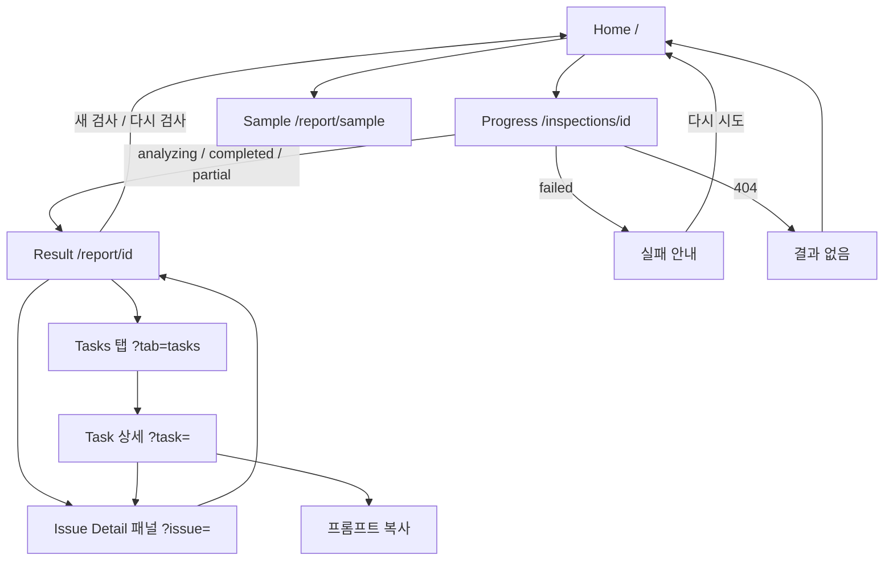

# AI Website Inspector — Wireframe Specification

> Version: 1.1
> Status: Draft
> Related Documents: PRD.md (v1.2), USER_FLOW.md (v1.1)

### Changelog (v1.0 → v1.1)

- 화면 경로와 구조를 USER_FLOW v1.1에 맞춤 (결과 화면 안의 Issue Detail 패널, Tasks 탭)
- 범위 밖 요소 제거: Viewport 선택 토글, Recent Inspections, 이슈 상태 변경
- 빠져 있던 Must 요소 추가: 최종 URL, 검사 범위 안내, Needs Review 그룹, Confidence와 certainty 배지, Source Hints, `analyzing` 상태, 샘플 리포트, 결과 없음 화면
- 진행 단계를 PRD `step` 7개로 통일
- 스크린샷 마커 좌표 계산 규칙 추가
- Task, Prompt, Copy를 구현 우선순위 P0(Must)로 조정
- UI 문구를 한국어로 통일 (이슈 유형, 상태, Priority 같은 코드 값은 영문 유지)

> PRD와 내용이 다르면 PRD를 따른다. 화면 이동과 상태별 동작은 USER_FLOW를 따른다. 색, 글꼴, 간격 같은 시각 스타일은 DESIGN_GUIDE에서 정한다.

---

## 1. Design Overview

### 1.1 Purpose

본 문서는 AI Website Inspector의 주요 화면 구조와 UI 컴포넌트, 사용자 인터랙션을 정의한다.

프론트엔드 개발자가 별도의 기획 해석 없이 화면을 일관되게 구현할 수 있도록 각 화면의 레이아웃과 구성 요소를 명시한다.

본 문서는 Low-fidelity Wireframe Specification이며 최종 시각 스타일을 확정하는 문서는 아니다.

### 1.2 Design Goals

1. 검사 결과를 빠르게 파악할 수 있어야 한다.
2. UI 문제와 실제 발생 위치를 쉽게 연결할 수 있어야 한다.
3. Desktop과 Mobile 결과를 직관적으로 비교할 수 있어야 한다.
4. 문제의 우선순위를 명확하게 구분해야 한다.
5. 측정한 사실과 AI 추론을 시각적으로 구분해야 한다.
6. 개발자가 문제를 이해하고 프롬프트를 복사하기까지의 과정이 간결해야 한다.

### 1.3 Design Direction

**Developer-focused Inspection Dashboard**

- 정보 중심의 레이아웃
- 명확한 정보 위계
- 높은 정보 밀도와 충분한 가독성
- 검사 결과와 증거를 중심으로 한 구성
- 불필요한 장식 및 과도한 카드 사용 지양

### 1.4 문구 규칙

- UI 문구는 한국어로 쓴다.
- 이슈 유형(`Text Overflow`, `Element Overlap`, `Viewport Overflow`), 하위 유형(`clipped` 등), Priority(`P0`~`P3`), viewport 태그(`mobile-only` 등), certainty(`confirmed` 등)처럼 코드와 연결되는 값은 영문 그대로 표시한다.
- 아래 와이어프레임의 문구는 예시이며, 실제 문구는 구현 시 다듬을 수 있다. 단, 의미를 바꾸지 않는다.

---

## 2. Global Layout

### 2.1 Application Structure

```text
┌──────────────────────────────────────────────────────────────┐
│ LOGO                                              새 검사     │
├──────────────────────────────────────────────────────────────┤
│                                                              │
│                         Main Content                         │
│                                                              │
└──────────────────────────────────────────────────────────────┘
```

### 2.2 Global Header

| Element | Description |
|---|---|
| Logo | 서비스 로고. 클릭하면 Home(`/`)으로 이동 |
| 새 검사 | Home으로 이동하는 버튼. Home 화면에서는 숨긴다 |

MVP에는 그 밖의 내비게이션 메뉴를 두지 않는다.

### 2.3 Global Container

- 콘텐츠는 중앙 정렬을 기본으로 한다.
- Home과 Progress는 좁은 단일 열을 쓴다.
- 결과 화면은 넓은 작업 영역을 쓴다.
- 정확한 최대 너비와 간격은 DESIGN_GUIDE에서 정한다.

---

## 3. Screen 01 — Home (`/`)

### 3.1 Purpose

검사할 웹사이트 URL을 입력하고 검사를 시작한다. 서비스의 핵심 가치를 짧게 전달하고 검사 시작까지의 단계를 최소화한다.

### 3.2 Layout

```text
┌──────────────────────────────────────────────────────────────┐
│ LOGO                                                         │
├──────────────────────────────────────────────────────────────┤
│                                                              │
│                  웹사이트 UI 문제를 찾아드립니다                 │
│        Find UI issues. Turn them into fixes.                 │
│                                                              │
│  ┌──────────────────────────────────────────┐ ┌───────────┐  │
│  │ https://example.com                      │ │ 검사 시작   │  │
│  └──────────────────────────────────────────┘ └───────────┘  │
│  ⚠ 올바른 URL 형식이 아닙니다. (오류 시)                        │
│                                                              │
│  검사 환경   Desktop 1440 × 900  ·  Mobile 390 × 844          │
│  검사 항목   Text Overflow · Element Overlap · Viewport Overflow│
│                                                              │
│                    샘플 리포트 보기 →                          │
│                                                              │
└──────────────────────────────────────────────────────────────┘
```

### 3.3 Components

| Component | Description |
|---|---|
| Hero Heading / Description | 서비스 소개 한두 줄 |
| URL Input | 검사할 URL 입력. 라벨은 화면에 보이지 않아도 접근성 라벨은 둔다 |
| 검사 시작 Button | Primary 버튼 |
| Error Message | 입력창 바로 아래. 형식 오류, 금지된 대상, 동시 실행 초과 |
| 검사 환경 안내 | 고정값 텍스트. 선택이나 토글 UI를 두지 않는다 |
| 샘플 리포트 링크 | `/report/sample`로 이동 |

### 3.4 Interactions

| Element | Action |
|---|---|
| URL Input | URL 입력. Enter로 제출 |
| 검사 시작 | 클라이언트 형식 확인 → `POST /api/inspections` → 성공하면 `/inspections/[id]`로 이동 |
| 샘플 리포트 보기 | `/report/sample`로 이동 |

다시 시도나 다시 검사로 들어온 경우 URL Input에 이전 URL을 채워 둔다. URL은 query string이 아니라 `sessionStorage`로 넘긴다. 검사 대상 URL 전체가 서버 접근 로그에 남지 않게 하기 위해서다(AGENTS.md 8장).

### 3.5 States

| State | UI |
|---|---|
| Empty | placeholder 표시, 버튼 활성 |
| Focused | Focus ring |
| Invalid | 입력창 오류 테두리, 아래 오류 메시지, 입력값 유지 |
| Submitting | 버튼 로딩 표시, 중복 제출 방지, 입력창 비활성 |
| Blocked / Too many | 입력창 아래 안내 메시지 (USER_FLOW 3.6) |

### 3.6 Responsive Behavior

- Desktop: 입력창과 버튼을 한 줄에 배치
- Mobile: 입력창과 버튼을 세로로 배치, 버튼 전체 너비

---

## 4. Screen 02 — Inspection Progress (`/inspections/[id]`)

### 4.1 Purpose

브라우저 검사가 정상적으로 진행되고 있는지 단계별로 보여준다.

### 4.2 Layout

```text
┌──────────────────────────────────────────────────────────────┐
│ LOGO                                              새 검사     │
├──────────────────────────────────────────────────────────────┤
│                                                              │
│                     웹사이트를 검사하는 중입니다                  │
│                     https://example.com                      │
│                        경과 시간 00:42                         │
│                                                              │
│   [✓] 브라우저 준비                                            │
│   [✓] Desktop 렌더링 및 측정                                    │
│   [●] Mobile 렌더링 및 측정                                     │
│   [ ] UI 문제 탐지                                             │
│   [ ] 검사 결과 저장                                           │
│   [ ] AI 원인 분석                                             │
│   [ ] 개발 태스크와 프롬프트 생성                                 │
│                                                              │
│   검사 결과가 저장되면 결과 화면으로 이동합니다.                     │
│   [ ■ 검사 중지 ]                                              │
│                                                              │
└──────────────────────────────────────────────────────────────┘
```

- "검사 중지"는 `pending`, `running`일 때만 보인다(API_SPEC 6A장). 누르면 바로 중지 안내로 바뀐다.
  중지 안내: 제목 "검사를 중지했습니다", 정보 Notice, [ 다시 검사 ] [ 홈으로 ]. 실패와 구분해 error 톤을 쓰지 않는다.
  중지 요청이 거절되면(이미 결과 정리 단계) 버튼 아래에 서버 문구를 보여준다.
- 단계 목록은 PRD 6.2.3의 `step` 7개다. 이 화면에서는 보통 앞의 5단계까지 보이고, `analyzing`이 되면 결과 화면으로 이동한다.

### 4.3 Components

- 검사 대상 URL
- 경과 시간 (`createdAt` 기준)
- Step List (단계별 상태 아이콘 + 라벨)
- 실패 안내 영역
- 다시 시도 Button
- 검사 중지 Button (Secondary, 진행 중일 때만)

### 4.4 Step Status

| Status | UI |
|---|---|
| 대기 | 빈 아이콘, 흐린 텍스트 |
| 진행 중 | 진행 아이콘, 강조 텍스트 |
| 완료 | 체크 아이콘 |
| 실패 | 실패 아이콘 + 실패 원인 |

아이콘만으로 상태를 구분하지 않는다. 스크린리더용 상태 텍스트를 함께 둔다.

### 4.5 Failed State

```text
│   [✓] 브라우저 준비                                            │
│   [✕] Desktop 렌더링 및 측정                                    │
│       제한 시간 안에 페이지를 불러오지 못했습니다.                   │
│       (NAVIGATION_TIMEOUT)                                    │
│   [✕] Mobile 렌더링 및 측정                                     │
│       제한 시간 안에 페이지를 불러오지 못했습니다.                   │
│                                                              │
│                      [ 다시 시도 ]                             │
```

- 실패 원인 문구는 USER_FLOW 9장을 따른다. 실패 코드도 작게 함께 표시한다.
- 다시 시도는 URL을 `sessionStorage`에 넣고 Home으로 이동한다(3.4).

### 4.6 Not Found State

```text
│                 검사 결과를 찾을 수 없습니다                       │
│            결과는 7일 동안 보관됩니다.                            │
│                                                              │
│          [ 새 검사 ]      샘플 리포트 보기 →                    │
```

같은 화면을 `/report/[id]`의 404에도 쓴다.

---

## 5. Screen 03 — Inspection Result (`/report/[id]`)

### 5.1 Purpose

서비스의 핵심 화면이다. 전체 검사 결과와 문제 위치를 빠르게 이해하고, 어떤 문제부터 고칠지 판단하게 한다.

### 5.2 Layout (넓은 화면)

```text
┌────────────────────────────────────────────────────────────────────────────┐
│ LOGO                                                            새 검사     │
├────────────────────────────────────────────────────────────────────────────┤
│  검사 결과                                        [AI 분석 중 ●]  [링크 복사] │
│  https://example.com → https://www.example.com/  (최종 URL)                 │
│  2026-11-13 17:20 검사 · Desktop 1440 / Mobile 390                          │
│                                                                            │
│  ┌ 검사 범위 안내 ───────────────────────────────────────────────────────┐   │
│  │ ⓘ Mobile 스크린샷은 5,000px까지만 저장되었습니다. (측정은 전체 페이지)  │   │
│  │ ⓘ 이 페이지에는 meta viewport가 없습니다.                             │   │
│  └──────────────────────────────────────────────────────────────────────┘   │
│                                                                            │
│  전체 12   P0 1   P1 3   P2 7   P3 1   ·  검토 필요 2   ·  Desktop 5 / Mobile 9│
│                                                                            │
│  ┌ DESKTOP 1440 × 900 ───────────────────┐ ┌ MOBILE 390 × 844 ────────┐     │
│  │                                       │ │                          │     │
│  │        스크린샷 + 이슈 마커              │ │   스크린샷 + 이슈 마커     │     │
│  │        (세로 스크롤)                    │ │   (세로 스크롤)           │     │
│  │                                       │ │                          │     │
│  └───────────────────────────────────────┘ └──────────────────────────┘     │
│                                                                            │
│  [ 이슈 12 ]  [ 개발 태스크 4 ]                                              │
│  ────────────────────────────────────────────────────────────────────────  │
│  Priority [전체 ▾]  Category [전체 ▾]  Viewport [전체 ▾]                     │
│                                                                            │
│  P0  Viewport Overflow · page-scroll   div.hero-visual      mobile-only  → │
│  P1  Text Overflow · clipped           button "지금 무료로…"  mobile-only  → │
│  P1  Element Overlap                   a "로그인" ↔ a "가입"  both        → │
│  P2  Text Overflow · spill             p "요금제에 포함된…"   desktop-only → │
│  …                                                                         │
│                                                                            │
│  ▸ 검토 필요 2  — 의도된 디자인일 수 있는 항목                                  │
└────────────────────────────────────────────────────────────────────────────┘
```

- Issue Detail은 이 화면 오른쪽에 패널로 열린다(6장).
- 탭 선택과 이슈 선택은 query(`?tab=`, `?issue=`, `?task=`)에 반영한다.

### 5.3 Header

| Element | Description |
|---|---|
| 페이지 제목 | "검사 결과" (샘플이면 "샘플 리포트") |
| 상태 배지 | `analyzing`: "AI 분석 중", `completed`: "완료", `partial`: "일부 실패" |
| 검사 URL / 최종 URL | 리다이렉트가 없으면 최종 URL을 생략한다 |
| 검사 시각 | 사용자 시간대로 표시 |
| 링크 복사 | `/report/[id]` URL 복사 (Should) |

### 5.4 검사 범위 안내 (Scope Notice)

해당 항목이 있을 때만 영역을 보여준다. 항목이 없으면 영역 전체를 숨긴다.

| 조건 | 문구 예시 |
|---|---|
| 실패한 viewport | Mobile 검사에 실패했습니다: {실패 원인}. Desktop 결과만 표시합니다. |
| 스크린샷 없음 (`SCREENSHOT_FAILED`) | {Viewport} 화면을 저장하지 못해 측정값으로 그린 배치도로 표시합니다. 측정과 이슈는 정상입니다. (두 viewport 모두면 "Desktop과 Mobile 화면을…" 한 문장) |
| 스크린샷 잘림 | {Viewport} 스크린샷은 {screenshotHeight}px까지 저장되어, 그 아래는 배치도로 표시합니다. |
| 요소 수 잘림 | 요소가 많아 문서 앞쪽 3,000개만 검사했습니다. |
| 이슈 수 잘림 (`issuesTruncated`) | 이슈가 {issuesDetected}개 발견되어 우선순위가 높은 상위 200개만 표시합니다. (PRD 5.3.7) |
| canvas 있음 | canvas 영역 안의 그래픽은 검사하지 않았습니다. canvas 블록이 첫 화면 면적의 절반 이상이면: 이 페이지는 canvas 영역이 커서, canvas 안의 그래픽은 검사하지 않았습니다. |
| meta viewport 없음 | 이 페이지에는 meta viewport가 없어 Mobile 화면 너비가 {layoutWidth}px로 측정되었습니다. |
| AI 실패 | AI 분석을 가져오지 못했습니다. 측정 결과와 태스크는 그대로 사용할 수 있습니다. |
| AI 분석 대상 초과 | 우선순위가 높은 30개 이슈만 AI가 분석했습니다. |
| Overlay 감지 | 화면을 크게 덮는 고정 요소가 있어 겹침 판정에서 제외했습니다: {selector} |

### 5.5 Summary

- 전체 개수, P0~P3 개수, Desktop / Mobile 개수. Needs Review는 모두 제외한다(PRD 7.3).
- "검토 필요 N개"를 따로 표시하고, 클릭하면 Needs Review 그룹을 펼치고 그 위치로 스크롤한다.
- Priority 개수를 클릭하면 해당 Priority 필터를 적용한다.
- 숫자는 tabular numbers로 표시한다.

### 5.6 Viewport Comparison

**원칙: 사진이 없는 부분은 항상 도면으로 채운다.** 어떤 경우에도 페이지 끝까지 보이고, 빈 도면은 없다. 시안: `docs/assets/mock/schematic-v2-hybrid.png`, `schematic-v2-canvas-only.png`, 원본 `schematic-v2-mock.html`.

```text
┌ MOBILE 390 × 844 ───────── 스크린샷 + 배치도 ┐
│ ┌──────────────────────────────────────────┐ │
│ │ 스크린샷 이미지                             │ │
│ │   ┌──────┐ ①                              │ │   ← 이슈 박스 + 번호 마커
│ │ ░░░░░░░░░░░░ (아래쪽 60px 흐리게) ░░░░░░░░ │ │
│ │ - - - - - - - - - ( 여기부터 배치도 (844px~) )│ │
│ │ ┊section#features (계속)┊                  │ │   ← 측정값으로 그린 도면 (격자 배경)
│ │ ┊ ▭▭▭ 주요 기능   ┌──────┐ ③              ┊ │ │
│ └──────────────────────────────────────────┘ │
│ 이슈 3 · 스크린샷 0~844px, 이후 배치도   사진|배치도 │
└──────────────────────────────────────────────┘
 ▭ 이슈 (색 = Priority)  ▨ 문제 영역  ┅ 첫 화면 · 화면 경계 · 사진 끝  ┆ 구조  ▨ canvas
```

미리보기는 다음 셋 중 하나다(`src/features/report/logic/preview.ts`).

| 경우 | 카드 헤더 오른쪽 | 내용 | 카드 하단 |
|---|---|---|---|
| 스크린샷 전체 | 스크린샷 | 사진 | 이슈 N |
| 스크린샷 일부 (`screenshotHeight` < `documentHeight`) | 스크린샷 + 배치도 | 사진 + 아래쪽 도면 | 이슈 N · 스크린샷 0~{screenshotHeight}px, 이후 배치도 |
| 스크린샷 없음 (`SCREENSHOT_FAILED`) | 배치도 · 스크린샷 없음 | 도면 | 이슈 N · 측정값으로 그린 배치도 · 문서 높이 N px |

- 실패한 viewport는 카드 대신 실패 원인을 표시한다.
- 사진 + 아래쪽 도면: 하나의 세로 스크롤 영역에서 사진 구간과 도면 구간이 같은 좌표계로 이어진다. 너비는 사진과 도면 모두 `max(screenshotWidth, layoutMap.width)`를 같은 비율로 줄인다(Mobile 축소 스크린샷). 경계는 사진 아래쪽 60px를 흰색으로 흐리게 하고, 파란 점선과 오른쪽 칩 "여기부터 배치도 ({screenshotHeight}px~)"를 둔다. 도면 구간에는 경계 아래에 걸친 블록만 그리고, 위쪽이 잘린 구조 블록은 label 뒤에 "(계속)"을 붙인다. 사진이 도면 높이 상한까지 덮으면 그 아래에 "문서가 길어 {N}px 아래는 배치도를 그리지 않았습니다."
- 도면만: 문서 가로 범위(`layoutMap.scrollWidth`)와 화면 밖으로 나간 이슈 박스까지 넓히고, 첫 화면 경계선(파란 점선, "첫 화면 끝 (900px)")을 긋는다. 문서가 화면보다 넓으면(Mobile) 세로 파란 점선 "화면 너비 390px"와 오른쪽 회색 "화면 밖"을 그린다. 도면 높이 상한에 걸렸으면 "배치도 끝 (10,000px)" 선 아래를 회색으로 둔다.
- 사진 | 배치도 전환(Should): 스크린샷이 있는 viewport는 카드 하단에서 전환할 수 있다. 기본은 사진이다.
- 미리보기 아래 범례 한 줄: 이슈(색 = Priority) / 문제 영역 / 첫 화면·화면 경계·사진 끝 / 구조 (section 등) / canvas
- 도면은 iframe으로 실제 페이지를 넣지 않는다. 삽입이 막힌 사이트가 많고, 측정 시점과 다른 화면이 나오며, 검사 대상 페이지를 서비스 화면 안에서 실행하게 되기 때문이다

**도면 그리기 규칙** (`src/lib/schematic.ts`, `src/components/inspection/SchematicLayer.tsx`, 시안의 `schematic()`과 같은 결과)

| 대상 | 표시 |
|---|---|
| 배경 | 흰색 + 격자(문서 기준 40px, `#eef0f3`), 페이지 좌우 윤곽선 `#c9ced6` |
| 구조 블록 | 회색 점선 테두리 `#9aa3af`. label은 모든 블록을 그린 뒤 맨 위에 흰 바탕 칩(테두리 `#d5dae0`)으로 그린다. 칩이 겹치면 오른쪽(넘치면 아래)으로 비켜 놓는다. 위쪽이 잘려 보이면 "(계속)" |
| heading | 연회색 막대 `#e9ecf0` + 굵은 진회색 label |
| text | 얇은 회색 막대 1~4줄 `#e3e6ea`, 마지막 줄은 짧게. label 없음 |
| image | 연회색 사각형 + 대각선 X + 가운데 label |
| button | 둥근 사각형(연회색 채움) + 가운데 label |
| input | 테두리만 있는 사각형 + 왼쪽 label |
| card | 얇은 실선 테두리, 채움 없음 |
| canvas, video, iframe | 연한 파랑 빗금 + 파란 점선 테두리 + 가운데 흰 칩 label |
| 이슈 박스 | Priority 색(P0 `#e5484d`, P1 `#f5a524`, P2 `#8b95a3`, P3 `#b8bfc9`), 도면 구간은 12% 채움, 왼쪽 위 번호 원 마커. 구조 블록 위에 그린다 |

- 선 굵기와 글자 크기는 화면 기준 px로 고정한다. 문서 좌표에 배율을 곱해 화면 좌표로 그린다(viewBox로 늘리지 않는다).
- label이 블록보다 길면 말줄임하고, 블록이 화면 기준 60×14px보다 작으면 생략한다. label은 페이지에서 가져온 문자열이라 SVG 텍스트로만 넣는다.

**빈 화면 방지:** 블록이 하나도 없거나 `layoutMap`이 없는 예전 문서면 최소 도면(격자, 페이지 윤곽, 첫 화면 경계선, 이슈 박스, 가운데 흰 카드 안내)을 그린다. `hasCanvas`면 "이 페이지는 대부분 canvas로 그려져 있어 구조를 표시할 수 없습니다. canvas 내부는 검사하지 않습니다.", 그 밖은 "표시할 구조 요소를 찾지 못했습니다." 이슈가 0개여도 도면은 그대로 보여주고, 이슈 목록에는 빈 상태 문구(5.12)를 둔다.

**마커 좌표 규칙**
- 미리보기 위에 SVG 오버레이를 겹치고, `viewBox`를 미리보기 좌표계 크기(사진만이면 `{screenshotWidth} × {screenshotHeight}`, 사진 + 도면이면 `{max(screenshotWidth, layoutMap.width)} × {max(documentHeight, 이슈 박스 아래쪽 끝)}`, 도면이면 가로를 이슈 박스 오른쪽 끝까지 넓힌 크기)로 둔다(DETECTION_RULES 3.1.1: Mobile 축소 시 스크린샷이 `layoutWidth`보다 넓다). 그 안에 `occurrence.boundingBox`(문서 기준 CSS px)를 그대로 그린다.
- 사진 구간과 도면 구간에서 마커 번호, 클릭, 선택 시 강조와 스크롤이 똑같이 동작한다. 좌표계 밖으로 나간 부분은 잘라 그리고, 그릴 수 없는 이슈만 "범위 밖" 개수에 넣는다.
- meta viewport가 없는 Mobile 페이지에서도 이 규칙이 맞는지 구현 시 Fixture로 확인한다.
- 마커 번호는 현재 필터를 통과한 이슈 목록의 순번이다. Needs Review 이슈는 그룹을 펼쳤을 때만 흐린 스타일로 표시한다.

**인터랙션**
1. 마커를 클릭하면 해당 이슈를 선택(`?issue=`)하고 Issue Detail 패널을 연다.
2. 목록에서 이슈를 선택하면 두 미리보기 모두 해당 마커를 강조하고 보이는 위치로 스크롤한다.
3. 마커에 마우스를 올리면 이슈 제목 툴팁을 표시한다. 핵심 정보는 툴팁에만 두지 않는다.
4. 측정 결과에 없는 마커를 만들지 않는다.

### 5.7 Tabs

| 탭 | 내용 |
|---|---|
| 이슈 {N} | 필터 + 이슈 목록 + 검토 필요 그룹 |
| 개발 태스크 {N} | 7장. `analyzing` 중에는 "AI 분석 중" 표시 |

### 5.8 Issue Filters

| Filter | Options |
|---|---|
| Priority | 전체 / P0 / P1 / P2 / P3 |
| Category | 전체 / Text Overflow / Element Overlap / Viewport Overflow |
| Viewport | 전체 / `mobile-only` / `desktop-only` / `both` |

- 필터는 조합할 수 있다. 필터 상태는 query에 반영하지 않는다(새로고침 시 초기화).
- 한 viewport가 실패한 검사에서는 Viewport 필터를 숨긴다.
- 필터 결과가 0개면 "조건에 맞는 이슈가 없습니다"와 필터 초기화 버튼을 표시한다.

### 5.9 Issue List Item

```text
P1  Text Overflow · clipped   button "지금 무료로 시작하기"   mobile-only   →
    내부 콘텐츠 너비(412px)가 컨테이너 너비(358px)를 54px 초과합니다.
```

| 항목 | 내용 |
|---|---|
| Priority 배지 | P0~P3 |
| 유형 | `{type} · {subtype}` |
| 대상 | 태그 + 텍스트 앞부분. 텍스트가 없으면 selector (길면 말줄임, 전체는 title 속성) |
| Viewport 태그 | `mobile-only` / `desktop-only` / `both` (비교 불가면 생략) |
| Evidence 요약 | 대표 occurrence의 Evidence 문장 한 줄 |
| Confidence | 1.0 미만일 때만 표시 |

- 정렬: Priority(P0 → P3) → Issue ID
- 클릭하면 Issue Detail 패널을 연다. 선택된 항목은 강조한다.

### 5.10 Needs Review Group

```text
▾ 검토 필요 2 — 의도된 디자인일 수 있는 항목
   P2  Element Overlap   span.badge ↔ img     both   Confidence 0.4   →
   …
```

- 기본으로 접혀 있다.
- 항목 구조는 5.9와 같고 Confidence를 항상 표시한다.

### 5.11 Analyzing State

- 이슈, 스크린샷, Evidence는 그대로 표시한다.
- 헤더 상태 배지 "AI 분석 중", 개발 태스크 탭에는 진행 표시를 둔다.
- Issue Detail의 AI 분석 영역은 로딩 상태로 표시한다.

### 5.12 Empty State

```text
┌──────────────────────────────────────────────┐
│        검사한 항목에서 문제가 발견되지 않았습니다     │
│  Text Overflow, Element Overlap, Viewport     │
│  Overflow 외의 문제는 검사하지 않았습니다.         │
└──────────────────────────────────────────────┘
```

- 스크린샷 미리보기는 그대로 표시한다.

### 5.13 Sample Report

- `/report/sample`은 같은 화면 구조를 쓴다.
- 헤더 위에 "샘플 리포트입니다" 안내와 "내 사이트 검사하기" 버튼을 둔다.
- 링크 복사 버튼은 숨긴다.

---

## 6. Screen 04 — Issue Detail (패널, `?issue=ISS-001`)

### 6.1 Purpose

개별 UI 문제의 위치, 측정 증거, 원인을 확인한다.

### 6.2 Layout (넓은 화면: 오른쪽 패널, 너비 약 480px)

```text
┌ Issue Detail ──────────────────────────────── [✕] ┐
│ ISS-004                                           │
│ Text Overflow · clipped — button "지금 무료로 시작하기" │
│ [P1]  mobile-only  Confidence 1.0                  │
│                                                   │
│ ── Evidence ─────────────────────────────────     │
│ Mobile 390 × 844                                  │
│ ┌───────────────────────────────────────────┐     │
│ │  하이라이트 스크린샷 (cropRect)               │     │
│ └───────────────────────────────────────────┘     │
│ 내부 콘텐츠 너비(412px)가 컨테이너 너비(358px)를     │
│ 54px 초과합니다. (overflow: hidden으로 잘림)         │
│                                                   │
│  measured   scrollWidth   412                     │
│  expected   clientWidth   358                     │
│  delta      overflowX      54                     │
│  Selector   [data-testid="hero-cta"]   [복사]       │
│  관련 요소   div.hero-actions (clipping-ancestor)    │
│                                                   │
│ ── 소스에서 찾기 ─────────────────────────────      │
│  Section     hero                                 │
│  Text        "지금 무료로 시작하기"                    │
│  Attributes  data-testid="hero-cta"               │
│  HTML        <button class="btn btn-lg" …>        │
│  Path        section#hero > div.hero-actions > …  │
│                                                   │
│ ── AI 원인 분석 ───────────────── AI 추론 ──        │
│  [likely]                                         │
│  버튼에 고정 너비(width: 180px)와 white-space:       │
│  nowrap이 함께 걸려 있어 …                           │
│                                                   │
│  수정 제안                                         │
│  ┌──────────────────────────────────────────┐     │
│  │ .btn-lg { width: auto; min-width: 180px; }│     │
│  └──────────────────────────────────────────┘     │
│                                                   │
│ ── 관련 개발 태스크 ──────────────────────────      │
│  TASK-001 모바일 Hero 영역 레이아웃 수정  [P0]   →    │
└───────────────────────────────────────────────────┘
```

### 6.3 Header

- Issue ID, Issue Title(코드 생성), Priority, Viewport 태그, Confidence
- 닫기 버튼과 Escape로 패널을 닫는다(`?issue=` 제거)

### 6.4 Evidence

- occurrence마다 반복한다(Desktop → Mobile 순). `both`면 두 블록이 나온다.
- 사진 / 도면 판정: 크롭 기준 박스(DETECTION_RULES 8.3, 패딩 전)가 스크린샷 `[0, screenshotWidth] × [0, screenshotHeight]` 안에 **완전히** 들어오고 `cropRect`가 있을 때만 사진 크롭이고, 아니면 도면이다. `cropRect`가 일부만 걸친 예전 문서도 화면에서 같은 기준으로 다시 판정한다. "스크린샷 범위 밖" 문구만 보여주는 화면은 없다.
- 하이라이트 스크린샷: 전체 스크린샷을 `cropRect` 영역만 보이게 잘라 표시하고, 대상 요소의 박스를 그린다.
- 이슈 도면: Evidence 제목 오른쪽에 "배치도"를 표시한다. 스크린샷은 있지만 범위 밖이면 도면 위에 "이 위치는 스크린샷 범위 밖이라 배치도로 표시합니다."(스크린샷이 아예 없으면 생략)
  - 영역: 크롭 기준 박스에 아래 도형을 더하고, 같은 여백(24px)과 최소 크기(320×160)를 쓴다. 화면 경계로 자르지 않는다. 영역과 겹치는 `layoutMap` 블록을 5.6의 규칙으로 함께 그린다(위쪽이 잘린 구조 블록은 "(계속)").
  - 공통: 대상 요소 박스(빨간 테두리, 안에 텍스트 일부), `relatedElements` 박스(회색 점선). 문제 영역은 빨간 빗금, 그 아래에 정수 px 치수 문구
  - viewport-overflow: 화면 밖은 회색 배경, 화면 경계에 파란 점선, `elementLeft`~`elementRight` 중 화면 밖 부분을 빗금으로("화면 밖 {n}px")
  - spill: 컨테이너(`bordered-ancestor`) 박스와 넘친 방향의 텍스트 범위("아래쪽 {n}px 넘침" 등)
  - clipped: 요소 박스, 위에 "{tag} (컨테이너 {clientWidth}px)", `scrollWidth − clientWidth`(또는 세로) 크기의 잘린 내용("잘린 {n}px"). 잘린 글자의 실제 위치는 저장되지 않아 요소 끝에 붙여 그리고, 그 사실을 안내한다
  - overlap: 대상 박스(빨강), 대표 상대 요소 박스(주황, 오른쪽 아래에 태그), 교차 영역 빗금
  - 도면 아래 캡션: "측정값으로 그린 배치도입니다. 글꼴과 색은 실제 화면과 다를 수 있습니다." 도형의 뜻은 SVG의 `aria-label`에도 넣는다.
- Header 아래 도구 (모든 이슈): "실제 페이지 열기"(최종 URL을 새 탭으로, http/https만)와 "개발자 도구에서 찾기"(콘솔에 붙여 넣을 `document.querySelector("{selector}")`를 복사). 실제 페이지는 검사 시점과 다를 수 있다.
- 측정값 표: `measured`, `expected`, `delta`의 키와 값. 값은 px 정수로 표시한다.
- Selector에는 복사 버튼을 둔다.
- 관련 요소: `relatedElements`의 selector와 역할. Element Overlap은 상대 요소를 반드시 표시한다. 첫 번째가 대표 상대 요소(교차 면적 최대)이고 최대 5개다. `measured.overlapTargetCount`가 5보다 크면 "외 {overlapTargetCount − 5}개 요소와도 겹칩니다"를 덧붙인다(PRD 5.3.3).
- `affectedDescendants`가 있으면 "이 요소 때문에 함께 넘친 하위 요소 {N}개"를 표시한다.

### 6.5 Source Hints (소스에서 찾기)

- 값이 없는 항목은 줄째로 생략한다.
- HTML은 문자열로만 표시한다(코드 블록). HTML로 렌더링하지 않는다.

### 6.6 AI 원인 분석

- 측정 영역과 시각적으로 구분하고, "AI 추론" 표시를 둔다.
- certainty 배지(`confirmed` / `likely` / `uncertain`)를 표시한다.
- 구성: 원인(rootCause), CSS 문제(cssProblem), 수정 방향(fixDirection), 수정 제안 코드(suggestedFix)
- 분석이 없으면 USER_FLOW 6.6의 이유별 문구를 표시한다.

### 6.7 관련 개발 태스크

- 이 이슈가 속한 태스크 1개를 표시한다. 클릭하면 `?tab=tasks&task=TASK-xxx`로 이동한다.
- 태스크가 아직 없으면(`analyzing`) "태스크 생성 중"을 표시한다.

### 6.8 Responsive

- 넓은 화면: 결과 화면 오른쪽에 고정 패널. 결과 화면은 왼쪽에서 계속 스크롤된다.
- 좁은 화면: 전체 화면 시트. 상단에 "← 결과로" 버튼.

---

## 7. Screen 05 — Development Tasks (탭, `?tab=tasks`)

### 7.1 Purpose

여러 UI 문제를 수정 작업 단위로 보여주고 AI Coding Prompt를 제공한다.

### 7.2 Layout (넓은 화면)

```text
[ 이슈 12 ]  [ 개발 태스크 4 ]
────────────────────────────────────────────────────────────────────────
태스크 4개 · 이슈 10개                          [ ] 검토 필요 태스크 표시

┌ 태스크 목록 ─────────────────┐ ┌ 태스크 상세 ─────────────────────────────┐
│ ● TASK-001  [P0]           │ │ TASK-001  모바일 Hero 영역 레이아웃 수정     │
│   모바일 Hero 영역 레이아웃…   │ │ [P0]  mobile-only  이슈 2개              │
│   이슈 2 · mobile-only      │ │                                          │
│                            │ │ 문제 설명                                 │
│   TASK-002  [P1]           │ │ 모바일 화면에서 Hero 영역의 …               │
│   상단 메뉴 겹침 수정         │ │                                          │
│   이슈 3 · both             │ │ 관련 이슈                                 │
│                            │ │  ISS-003 [P0] Viewport Overflow · …  →   │
│   TASK-003  [P2]           │ │  ISS-004 [P1] Text Overflow · …      →   │
│   …                        │ │                                          │
│                            │ │ 이슈별 원인과 수정 제안 (접기/펼치기)         │
│                            │ │                                          │
│                            │ │ Acceptance Criteria                      │
│                            │ │  - 390px viewport에서 …                   │
│                            │ │                                          │
│                            │ │ 프롬프트                       [ 복사 ]    │
│                            │ │ ┌──────────────────────────────────────┐ │
│                            │ │ │ # Task: 모바일 Hero 영역 레이아웃 수정   │ │
│                            │ │ │ Priority: P0 | Viewport: mobile-only │ │
│                            │ │ │ …                                    │ │
│                            │ │ └──────────────────────────────────────┘ │
│                            │ │ 수정한 내용은 저장되지 않습니다.              │
└────────────────────────────┘ └──────────────────────────────────────────┘
```

### 7.3 Layout Structure

- 넓은 화면: 왼쪽 태스크 목록, 오른쪽 태스크 상세
- 좁은 화면: 목록 → 상세로 이동하는 2단계 구조. 상세 상단에 "← 태스크 목록"

### 7.4 Task List Item

- Task ID, Priority 배지, 제목, 이슈 수, Viewport 태그
- 제목이 코드 템플릿(`titleSource: 'template'`)이면 작은 "자동 제목" 표시
- 정렬: PRD 5.8.1(Priority → 가장 작은 Issue ID). 처음에는 첫 번째 태스크를 선택한다.
- Needs Review 태스크는 "검토 필요 태스크 표시"를 켰을 때만 목록 아래에 구분선과 함께 표시한다(Should).

### 7.5 Task Detail

- 제목, Priority, Viewport 태그, 이슈 수
- 문제 설명
- 관련 이슈 목록(클릭하면 Issue Detail 패널을 연다)
- 이슈별 원인과 수정 제안(이슈마다 접기/펼치기, certainty 배지 포함)
- Acceptance Criteria
- 프롬프트 textarea + 복사 버튼

### 7.6 Prompt Interaction

- textarea에는 `DevTask.prompt`를 그대로 채운다. 편집할 수 있지만 저장하지 않는다. 다른 태스크로 이동하면 원래 내용으로 돌아간다.
- 복사 버튼은 textarea의 현재 내용을 복사한다(Clipboard API).
- 복사하면 버튼 라벨이 2초 동안 "복사됨"으로 바뀌고, 스크린리더에도 알린다.
- 복사에 실패하면 textarea 전체를 선택하고 "직접 복사해 주세요"를 표시한다.
- textarea는 기술용 글꼴과 고정된 높이(내부 스크롤)를 쓴다.

### 7.7 States

| State | UI |
|---|---|
| `analyzing` | "AI 분석과 태스크 생성 중입니다." + 진행 표시 |
| 이슈 0개 | "생성된 태스크가 없습니다." + 이슈 탭으로 이동 버튼 |
| AI 실패 | 태스크는 표시하고, 상단에 "AI 분석 없이 자동 제목으로 만든 태스크입니다." 안내 |

---

## 8. Reusable UI Components

AGENTS.md 3장의 폴더 구조를 따른다. 도메인을 모르는 공통 UI는 `src/components/`, 화면 기능에 속한 컴포넌트는 `src/features/*`에 둔다.

| Component | 위치 | Responsibility |
|---|---|---|
| Header, PageContainer | `components/layout` | 공통 헤더, 콘텐츠 폭 |
| Button, Input, Tabs, Badge, Textarea, CopyButton, Notice | `components/ui` | 공통 UI |
| EmptyState, ErrorState, LoadingState | `components/ui` | 공통 상태 표시 |
| UrlForm | `features/inspection-form` | URL 입력, 형식 확인, 제출 |
| ProgressSteps, NotFound | `features/inspection-progress` | 단계 목록, polling, 실패 안내 |
| ReportHeader, ScopeNotice, Summary | `features/report` | 결과 상단 |
| ScreenshotViewer, IssueMarkers | `features/report` | 스크린샷과 SVG 마커 |
| IssueFilters, IssueList, IssueListItem, NeedsReviewGroup | `features/report` | 이슈 목록 |
| PriorityBadge, ViewportTagBadge, IssueTypeLabel, CertaintyBadge | **위치 미정 (아래 참고)** | 코드 값 표시 배지. report, issue-detail, dev-tasks가 함께 쓴다 |
| IssueDetailPanel, EvidenceBlock, CropView, MeasurementTable, SourceHints, AiAnalysis | `features/issue-detail` | 이슈 상세 |
| TaskList, TaskDetail, PromptEditor | `features/dev-tasks` | 태스크와 프롬프트 |

- 여러 feature에서 쓰는 컴포넌트는 `components/`로 옮긴다. feature끼리는 서로 import하지 않는다.
- **충돌:** AGENTS.md는 `components/`를 "도메인을 모르는 UI"로 정의한다. 그런데 Priority, viewport 태그, certainty 배지는 도메인 값을 알아야 하고 여러 feature가 함께 쓴다. AGENTS.md를 수정할 때 다음 중 하나로 정한다.
  - (권장) `src/components/inspection/`을 두고, `types`만 import하는 표시 전용 도메인 컴포넌트를 허용한다.
  - `components/ui/Badge`는 `label`과 `tone`만 받고, 값 → 라벨/색 변환은 각 feature가 한다(변환 코드가 중복된다).
- 결과 화면(`app/report/[id]/page.tsx`)이 feature들을 조립하고, 선택 상태(`?issue=`, `?tab=`, `?task=`)를 props로 넘긴다.

---

## 9. Navigation Flow



---

## 10. Responsive Design Rules

Breakpoint 값은 DESIGN_GUIDE를 따른다(Mobile < 640px, Tablet 640–1023px, Desktop ≥ 1024px).

### 10.1 Desktop

- Desktop / Mobile 미리보기를 나란히 배치한다. Desktop 미리보기 영역이 더 넓다(약 2:1).
- Issue Detail은 오른쪽 고정 패널.
- 태스크 목록과 상세를 2열로 배치한다.

### 10.2 Tablet

- 미리보기를 나란히 두되 높이를 줄인다. 너비가 부족하면 탭으로 전환한다.
- Issue Detail은 오른쪽 패널(오버레이).
- 필터 영역은 줄바꿈을 허용한다.

### 10.3 Mobile

- 모든 영역을 세로로 배치한다.
- 미리보기는 Desktop / Mobile 탭으로 전환한다.
- Issue Detail과 태스크 상세는 전체 화면 시트.
- 주요 버튼은 터치하기 쉬운 크기(44×44px 이상)를 유지한다.
- 서비스 화면 자체에 가로 스크롤이 생기면 안 된다.

---

## 11. Interaction Principles

### 11.1 Feedback

- 검사 시작 → 버튼 로딩 → 진행 화면
- URL 오류 → 입력창 아래 메시지
- 프롬프트 복사 → "복사됨"
- 링크 복사 → "링크가 복사되었습니다"

### 11.2 Loading

| 대상 | 표시 |
|---|---|
| 검사 시작 요청 | 버튼 로딩 |
| 결과 첫 조회 | 화면 골격(skeleton) |
| AI 분석, 태스크 생성 | 해당 영역의 "AI 분석 중" 표시 |
| 스크린샷 이미지 | 이미지 자리 배경 + 로딩 표시 |

### 11.3 Error

오류 발생 시 다음을 알려준다.

- 무엇이 실패했는가?
- 왜 실패했는가? (실패 코드 포함)
- 사용자가 무엇을 할 수 있는가? (다시 시도, 새 검사, 샘플 보기)

### 11.4 Accessibility

- 버튼과 입력창에 명확한 라벨을 둔다.
- 키보드로 모든 주요 기능에 접근할 수 있다. 패널과 시트는 Escape로 닫는다.
- 스크린샷 마커는 키보드로 선택할 수 없어도 된다. 같은 기능을 이슈 목록이 제공한다.
- 상태를 색만으로 구분하지 않는다.
- 진행 상태 변화와 복사 완료는 live region으로 알린다.

---

## 12. Design Decisions (v1.0 Provisional 확정)

| Item | Decision |
|---|---|
| Global Navigation | 단순한 상단 헤더 (로고, 새 검사) |
| Main Layout | 중앙 정렬, 결과 화면은 넓은 작업 영역 |
| Result Preview | 넓은 화면은 좌우 비교, 좁은 화면은 탭 |
| Issue Navigation | 스크린샷 마커 + 이슈 목록, 같은 `?issue=` 상태 공유 |
| Issue Detail | 결과 화면 안의 패널 (좁은 화면은 전체 화면 시트) |
| Task Layout | 2열 (좁은 화면은 단계 이동) |
| Prompt | 편집 가능한 textarea, 저장하지 않음 |
| Recent Inspections | 제공하지 않음 (PRD Won't) |
| Viewport 선택 | 제공하지 않음, 고정값 안내만 (PRD Won't) |
| Issue Status | 제공하지 않음 (PRD Won't) |

---

## 13. Implementation Priority

PRD 5.0과 USER_FLOW 13장을 따른다.

### P0 — Must

- Home (URL 입력, 오류 표시, 샘플 링크)
- Progress (단계 목록, polling, 실패 안내, 결과 없음)
- Result: Header, Scope Notice, Summary, 미리보기와 마커, 이슈 목록, Needs Review 그룹, `analyzing` 상태, Empty State
- Issue Detail 패널 (Evidence, 하이라이트, Source Hints, AI 분석)
- Development Tasks (목록, 상세, 프롬프트 textarea, 복사)
- Sample Report
- Loading / Error / Empty 상태

### P1 — Should

- 이슈 필터 (Priority / Category / Viewport 태그)
- 링크 복사 (공유 URL)
- 검토 필요 태스크 표시 토글
- 진행 화면의 단계별 상세 표시

### Won't (MVP)

- Recent Inspections, Viewport 선택, Issue Status, 스크린샷 확대/축소 같은 고급 상호작용

---

**Document Status:** Draft v1.1
**Next Step:** DESIGN_GUIDE를 v1.2 PRD와 이 문서에 맞춰 수정한다.
